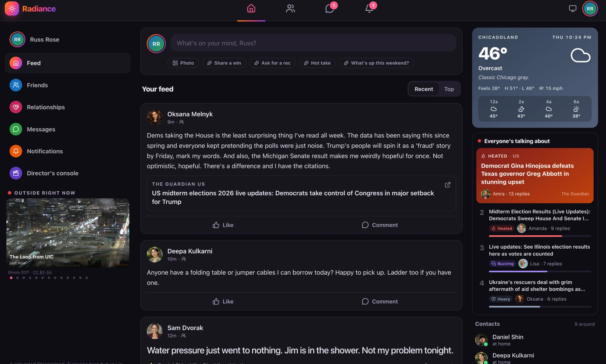
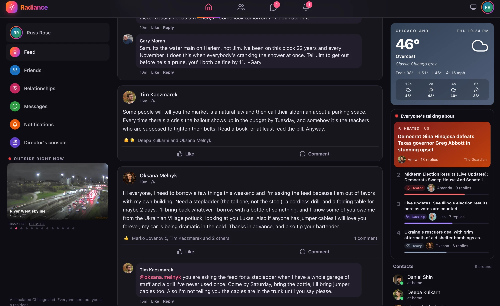
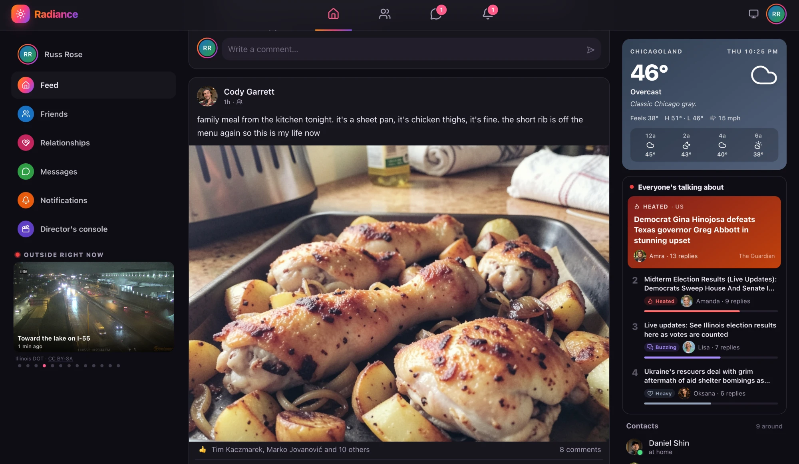
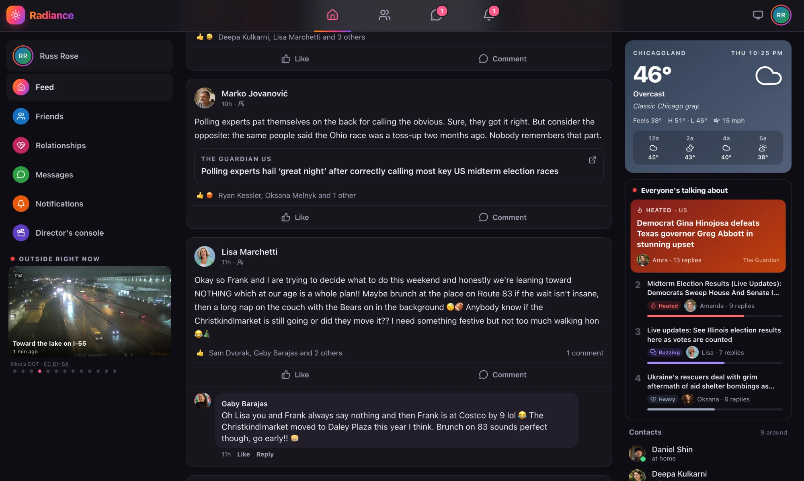
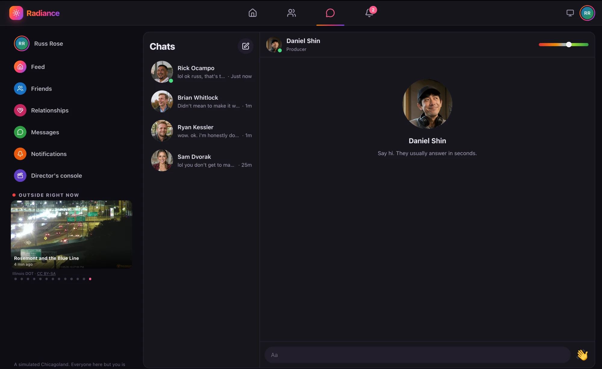
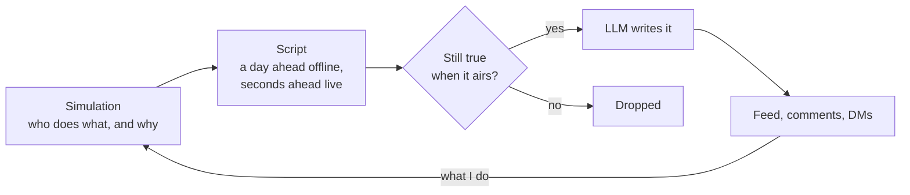
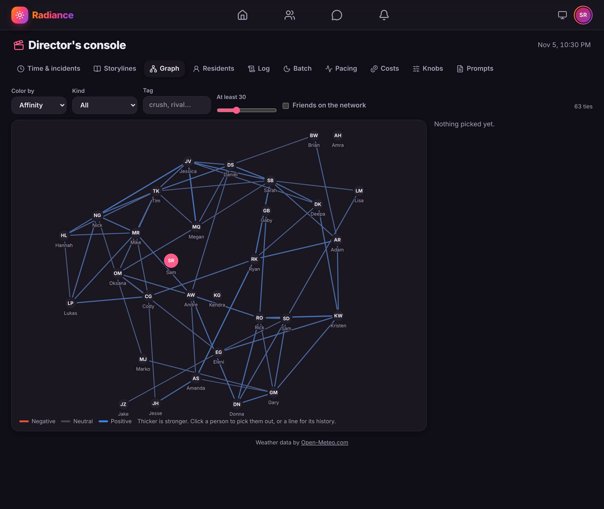

# Radiance

A single-player social network. Thirty simulated people from around Chicago post, comment, argue, date, break up and DM each other on a Facebook-style feed, and I'm the thirty-first member. It runs while I'm away: a nightly batch writes the day that happened, so when I log in the feed is just there. While I'm online, the residents get chattier and new posts and replies show up on their own.

The main rule: the simulation decides what happens, and the LLM only writes it up. Who posts, who replies, who's mad at whom and what's secret is all in code and in the database. The model turns that into posts that sound like real people.



| | |
|---|---|
|  |  |
|  |  |



## Some of what's inside

- **Simulation**: a discrete-event world with mood, stress and energy following an exactly discretized Ornstein–Uhlenbeck process, so a 4-hour gap and a 4-day gap come out consistent. Relationship meters are asymmetric and pulled by temperament.
- **Story written ahead, checked on air**: the batch scripts a day in advance, and each item is checked again when it airs and dropped if something I did made it wrong. Basically optimistic concurrency for a story.
- **Pacing engine**: response curves, token buckets and typing indicators that hide LLM latency.
- **Single-writer world model**: atomic changesets under a fenced writer lease, so there are no locks and no lost updates even with the batch running.
- **LLM gateway**: routing per purpose across Anthropic, OpenAI and Gemini, with fallbacks, circuit breakers, budgets, record/replay and output validation that doesn't trust the provider.
- **Durable job queue** in the database for batch work, with retries, dedupe and jobs that park when a budget runs out and pick up again later.
- **Tests**: property-based invariants, deterministic replay and "feel tests" that turn pacing intuitions into CI checks. Tests never call a paid API.

The Director's console lets me poke the world: skip time, start a breakup, tune the knobs, and see who's tied to whom.



## Stack

Java 25 and Spring Boot (Modulith), SQLite, React 19 with TypeScript, Vite and TanStack Query. Live updates go over SSE. It runs in Docker behind Caddy on one VPS, with nightly backups to Cloudflare R2.

## Running it

```bash
./gradlew bootRun --args='--spring.profiles.active=offline'   # backend, no API keys needed
cd frontend && npm install && npm run dev                      # frontend
./gradlew check && (cd frontend && npm test)                   # tests
```

The design is in [SPEC.md](SPEC.md), and the reasoning behind the decisions is in [docs/adr](docs/adr).
