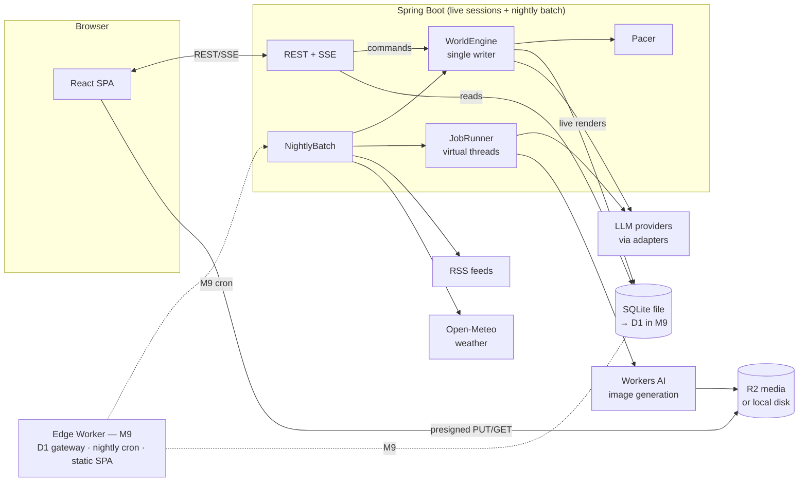

# Radiance — V1 Build Spec

> **For R:** Create an empty git repo, save this file at its root as `SPEC.md`, start Claude Code in that folder, and paste the kickoff message below. Before kickoff, look over §6.2 (the roster), §6.3 (pinned storylines) and §9 (default knobs, including the arc blacklist and the event and news mixes).
>
> **For Claude Code:** This document is the source of truth for the project. Read all of it before writing any code. Section 0 is your working agreement.

Kickoff message:

```
Read SPEC.md in full before doing anything else. It is the source of truth for this project, and §0 is your working agreement.

Then reply with (1) anything in the spec that looks contradictory, outdated or underspecified, with evidence, and (2) your plan for M0 and M1. Don't write code yet.

Once I approve, start M0 (create CLAUDE.md from Appendix E first) and work milestone by milestone. Stop at every ⏸ REVIEW checkpoint and tell me exactly what to look at.
```

Spec version 1.7 · 2026-10-27 · platform facts verified 2026-10-26/27 (Appendix C) · version history in Appendix G

**Contents** — 0 Working agreement · 1 What we're building · 2 Principles · 3 Architecture & stack · 4 Data model & persistence · 5 Systems · 6 Genesis · 7 API · 8 Frontend · 9 Configuration · 10 Testing · 11 Engineering showcase · 12 Milestones · 13 Later · Appendices A–G

---

## 0. Working agreement (for Claude Code)

- Work milestone by milestone (§12). A milestone is done when its acceptance criteria pass, `./gradlew check` and the frontend tests are green, `PROGRESS.md` is updated, and the work is committed in small conventional commits.
- Stop at every **⏸ REVIEW** checkpoint and tell R exactly what to look at.
- The spec decides most things. Where it says **Your call**, or where it is silent, pick the simplest option that satisfies §2 and record it as an ADR in `docs/adr/` (one page max: context, decision, consequences). If a choice would be expensive to reverse, ask R first.
- If the spec contradicts reality (a library API differs, a platform limit changed), stop and say so with evidence. Never silently work around it.
- No dependency outside §3.4, no new process, and no new external service without an ADR.
- Automated tests never call a paid API (LLM or image generation). Use the fakes. Live contract tests are opt-in via `@Tag("live")`.
- Keep `PROGRESS.md` current: done, next, deviations from spec, open questions for R.
- **Work in resumable bouts.** Your token budget will run out mid-task and reset later, so make every stopping point a clean one. Split each milestone into steps that end green and committed (WIP commits on a branch are fine), and keep a **Resume here** block at the top of `PROGRESS.md`: the current step, anything half-done, the next command to run. Update it before you stop, and whenever R says the budget is low. A new session reads `CLAUDE.md`, `PROGRESS.md` and the last few commits, then picks up from **Resume here** without redoing finished work.
- First task of M0: create `CLAUDE.md` from Appendix E so these rules survive context resets.

---

## 1. What we're building

A single-player social network called **Radiance**. Thirty simulated residents of Chicagoland — the city and its suburbs — live their lives on a Facebook-style network, and R is the thirty-first member. Inspirations: RimWorld's storyteller and emergent narrative, automatic story generators, game pacing, and the texture of real small-community Facebook.

**North-star scenario.** R hasn't logged in for four days. He opens the app and the feed is simply there, because the nightly batch wrote each day as it came. A recap card says: Sarah and her boyfriend broke up on Tuesday; Jesse bought another fixer-upper car and, by consensus, got ripped off again; Tim and Sarah went at it about socialism under a news link; Sam's kitchen renovation hit a plumbing setback. Under Sarah's breakup post her usual supporters offer condolences, Jake is trolling, and a vague post from Sarah about "some people" who "need to learn to read the room" makes it obvious Mike has been in her DMs. Jessica, who has been quietly seeing someone for a month without telling anyone, skipped the group's wine night with a flimsy excuse — her best friend's comment has a suspicious 👀. R's photo from the lakefront has fourteen reactions and a string of comments, and one of them suggests she finds him a bit pretentious. R replies. Within seconds a like lands and a small +2 floats over her name, then she answers, then Jake jumps in — quick feedback at a game's pace, never a flood.

**Pillars**
1. **Alive, not a puppet show.** Everyone has their own life, schedule and agenda. R's posts get more than their share of attention, by design and by a knob, but residents respond as themselves: the grouch still grumbles, and nobody is there just to applaud.
2. **Continuity.** The world remembers. Storylines progress in real time and never vanish silently. A secret stays secret until it leaks; a renovation drags on for months.
3. **Earned relationships, generous attention.** Every resident has a Sims-style like-meter for R, and for each other, that moves with every interaction. Impressions come from what R actually posts and says — some like him, some find him pretentious, some develop a crush — while his posts, photos most of all, draw plenty of engagement and his replies the least.
4. **Game-paced.** No waiting: the day is ready whenever R logs in, and while he's on, residents answer in seconds, paced like a good game.
5. **Grounded.** Chicagoland, today: real places, real weather, real headlines (mostly national, some world, a little local), real holidays and seasons, mundane life, the real register of Facebook.
6. **Cheap.** Pennies per day, every token metered; spending tapers off while R is away.

**Non-goals for V1:** video, voice, more than one human user, native mobile apps, Groups/Marketplace/Events/Stories, realistic reply delays, embeddings or vector search, microservices.

---

## 2. Principles (non-negotiable)

**P1 — Simulate in code, narrate with the LLM.** Who does what, when, to whom and with what stance is decided by deterministic, seeded code: a discrete-event simulation with utility-based decisions and a RimWorld-style storyteller. The LLM turns those decisions into words. LLM output may feed the planner only as stored, structured inputs produced earlier (a headline classification, an appraisal of R's post), never as a call inside the planning loop. *Why: cost, speed, testability, and continuity guarantees all live in code.*

**P2 — The ledger is canon.** Major facts (relationships, jobs, moves, purchases that matter, names of new people) are created only by the engine. Prose may add minor details ("a used tile saw"); those are extracted and recorded so they stay true. Nothing ends silently: every storyline closes with an event.

**P3 — One planner, two horizons.** The same planner runs ahead of time in two places: the nightly batch writes the next day's script, and live play scripts R's interactions seconds ahead. Both produce future-dated items that *air* when their time comes, and `WorldEngine.advanceTo(t)`, which airs them, is the only way committed time moves.

**P4 — Single writer.** All world-state mutations run on one writer lane against an in-memory world model and persist as atomic changesets, guarded by a fenced writer lease so a batch process and the app can never write at once. API reads go to the database. *Why: no lost updates and no locking, and it matches the single-writer nature of SQLite and D1.*

**P5 — Every token is budgeted.** Every LLM call goes through one gateway that meters cost, enforces budgets, maximizes prompt-cache hits and degrades gracefully. Budgets and provider quotas run in windows that reset, and all non-live work is small resumable jobs that park when a window runs dry and pick up when it reopens (§5.15).

**P6 — Deterministic by default.** Inject `Clock` and `RandomSource` (seeded per world and per slice). Same seed + same inputs + fake LLM ⇒ identical world. That is how we test a story engine.

**P7 — Content is data.** Quirks, events, arcs, constraint tags, pacing rules, prompt templates and the starting cast are versioned files, validated at startup, so the world is tunable without code changes.

**P8 — Complexity must earn its keep.** Deliberately not doing:

| Not doing | Instead | Revisit when |
|---|---|---|
| Microservices, message broker | Modular monolith; DB-backed job table | Not for this project |
| JPA/Hibernate | SQL behind a small port + atomic changesets | — |
| Vector DB / embeddings | Structured memory retrieval (participants, tags, arcs, recency) | Retrieval quality measurably suffers |
| Full event sourcing | Append-only event log as audit trail + projection tables | — |
| Batch framework (Spring Batch, Airflow) | One idempotent, resumable batch command and a cron trigger | The batch outgrows one process |
| LLM frameworks (Spring AI, LangChain4j) | Our own thin port and small HTTP adapters | We need tool calling, agents or many more providers |
| Vendor LLM SDKs | Plain HTTP via Spring `RestClient` | A provider feature we need is SDK-only |
| WebSockets | SSE for server→client, REST for client→server | Client→server streaming is needed |
| Redux or another global store | TanStack Query + SSE cache patching | — |
| Kubernetes | One process; a scale-to-zero container in M9 | — |

**P9 — Real people, a few hard lines.** This is the real world, not a sanitized one. Residents swear, mock, gossip, hold grudges and fight; some are biased or outright bigoted, and it shows the way it does on real Facebook — loaded jokes, "just saying", open contempt, the occasional ugly pile-on — while others push back, laugh along or scroll past. Balance is the default: it's a community, not a war, and knobs set how often things turn ugly (§5.8). Prose is never softened, disclaimed or moralized; the narrator never takes sides, and no side is a strawman. Politics spans the spectrum with real arguments and real contempt, and faith is fair game too. The hard lines are few: all residents are adults (22–70), nothing sexualizes minors, and sex stays non-explicit; no real private individuals; public figures appear only as subjects of real headlines, and residents can mock and insult them freely but never invent quotes or claims about them or threaten them; no images of real people or of children.

**P10 — Providers are plug-ins.** The domain asks the `LlmGateway` for a *purpose* (render a thread, appraise a post) in its own terms: prompt blocks in, a typed record out. Which provider and model serve each purpose is configuration, chosen by the bake-off and the cost meter, and it can change per purpose without code changes. No provider SDK, type or parameter name appears outside its adapter, and the guardrails — output validation, the linter, the blacklist, budgets — live in our code, so they hold whichever model is behind them.

---

## 3. Architecture & stack

### 3.1 Reality check: Java + Cloudflare

- Cloudflare Workers run JavaScript/WASM isolates, not a JVM. Spring Boot cannot run there.
- D1 is built for Worker bindings. Its REST API is meant for administration and is subject to Cloudflare's global API rate limit; Cloudflare's documented pattern for outside access is a small Worker in front of the database.
- Cloudflare Containers can run a JVM and scale to zero, and a Worker's Cron Trigger can start one on a schedule (Cloudflare's "Cron Container" pattern). Containers require the Workers Paid plan ($5/month with included usage).
- The JVM only has to exist while R is using the app and for a few minutes each night while the batch runs. Scale-to-zero hosting with a nightly wake-up fits that exactly.

**Decision.** Development is local-first: Spring Boot and Vite on R's machine, SQLite written in D1's dialect, and Cloudflare R2 (media) and Workers AI (image generation) from day one, both behind ports with local fakes. Until M9, the nightly batch runs on R's machine whenever it's on. M9 moves the database to D1 behind an edge Worker — which also serves the SPA and fires the nightly batch on a Cron Trigger — and runs the JVM in a scale-to-zero container, so the batch runs while R's computer is off.

### 3.2 Topology



### 3.3 Inside the JVM

- **`WorldEngine`** — the single writer lane: a real-time discrete-event loop on one dedicated thread. Owns the in-memory world model (actors, state, relationships, arcs, entities, facts, and the pending script). It sleeps until the next due item or the next command, airs scripted items when their time comes (§5.1), applies R's actions and plans live responses. Every change commits as one `UnitOfWork`. It loads the model from the DB whenever it acquires the writer lease, and never calls the LLM, image or news services itself.
- **`Pacer`** — decides when live responses to R become visible (§5.1). It owns timing and order only; the engagement model decides who responds.
- **`NightlyBatch`** — the batch run mode (§5.1): airs what's due, backfills missed nights, writes and renders the next script, runs maintenance and records a report. Runs in-process when the app is up, or as a one-shot process.
- **`JobRunner`** — polls the `job` table and runs batch rendering, images, RSS, compaction and other background work on virtual threads with per-kind concurrency limits (semaphores). Live interactions don't go through it: their renders start immediately on virtual threads, and the PLANNED rows they leave behind are the recovery record if the process dies. Results commit through the writer lane.
- **`LlmGateway`** — the only way to reach a model: routes each purpose to a provider adapter, validates the output, and meters cost (§5.10).
- **`SseHub`** — after each commit, pushes the changes the browser cares about.
- **API controllers** — reads go straight to the DB; writes are submitted to the writer lane as commands and awaited (they take milliseconds).

### 3.4 Stack

| Area | Choice |
|---|---|
| Language/runtime | Java 25 (LTS) |
| Framework | Spring Boot 4.1.x (latest patch), Gradle Kotlin DSL |
| Web | Spring Web MVC + virtual threads (`spring.threads.virtual.enabled=true`); `SseEmitter` for SSE |
| Security | Spring Security, single local user (§5.17) |
| Data | `sqlite-jdbc` (xerial) via Spring `JdbcClient`, wrapped by our `Sql` port (§4.2); in-house migration runner |
| LLM | Our `LlmGateway` port with small HTTP adapters on Spring `RestClient`: OpenAI-compatible Chat Completions and Anthropic Messages (§5.10); no vendor SDKs |
| Object storage | AWS SDK for Java v2 S3 client + presigner, pointed at R2 |
| Other HTTP | Spring `RestClient` (Workers AI, RSS, Open-Meteo, D1 gateway) |
| Scheduling | Spring `@Scheduled` locally; the edge Worker's Cron Trigger from M9 |
| Content defs | YAML (Jackson YAML or SnakeYAML) |
| Observability | Actuator + Micrometer |
| Tests | JUnit (Boot-managed), AssertJ, jqwik for property tests (if compatible with the Boot-managed JUnit Platform; otherwise seeded loops), Spring Modulith (core + test) for module-boundary verification only |
| Frontend | React (current stable) + TypeScript + Vite, TanStack Query, React Router, Tailwind CSS, lucide-react, native `EventSource`; `react-force-graph-2d` in the Director's console only |
| Frontend tests | Vitest + Testing Library; one Playwright smoke test |
| Edge (M9) | TypeScript Worker via Wrangler: D1 binding, Cron Trigger, Container binding, static assets |

No vendor LLM SDKs in V1: each provider's API is a handful of JSON shapes, and owning them keeps one JSON library (Spring Boot's Jackson 3), one error-handling path and no SDK version drift. A vendor SDK can come back behind the same port if a feature needs it.

### 3.5 Modules and repository layout

Package by feature, verified by Spring Modulith (`ApplicationModules.of(App.class).verify()`). The domain core (`cast`, `graph`, `story`, `sim`, `memory` internals and the Pacer's rules) is plain Java with no Spring and no I/O: a functional core with an imperative shell. Use records for values and sealed interfaces for intent and event hierarchies.

```
backend/src/main/java/app/radiance/        (rename the base package as you like)
  kernel/       Ulid, Clock, RandomSource, Json helpers, Result types
  persistence/  Sql port, JdbcSql, D1Sql (M9), UnitOfWork, migrations, writer lane, writer lease
  world/        World, WorldClock, settings, calendar, recap
  cast/         actors (bots + R), personas, traits, state & drift, routines, presence
  graph/        relationships, impressions, connections, friend requests
  story/        storyteller, event & arc engines, constraints, blacklist, facts, entities, knowledge, auditor
  sim/          WorldEngine, slice planning, script & airing, fidelity, backfill, intents, engagement model
  live/         live response planning, Pacer, typing indicators, hooks
  batch/        NightlyBatch, run reports, schedule triggers
  social/       posts, comments, reactions, feed, notifications, mentions
  messenger/    DMs
  llm/          LlmGateway, purposes & routes, adapters, output schemas & validation, metering, record/replay, bake-off
  narrative/    context packets, prompt templates, render paths, prose validators (linter, facts, LLM-isms)
  memory/       memories, retrieval, compaction
  news/         RSS ingestion, classification, selection
  weather/      WeatherSource (Open-Meteo, fake), hourly weather, named conditions
  media/        MediaStore (local/R2), presigned URLs, ImageGenerator, vision appraisal
  jobs/         job table, JobRunner
  api/          REST controllers, DTOs, SseHub
  director/     Director's console endpoints
backend/src/main/resources/content/   cast/, quirks/, events/, arcs/, constraints/, rules/, prompts/
frontend/                              React app
edge/                                  Worker (M9)
docs/adr/                              ADRs
SPEC.md  CLAUDE.md  PROGRESS.md  .env.example
```

---

## 4. Data model & persistence

### 4.1 Conventions

- **IDs:** ULIDs as `TEXT`, generated in Java (time-sortable, cursor-friendly).
- **Time:** every timestamp is `INTEGER` epoch milliseconds UTC, in *world time*. World time = wall time + `world.time_offset_ms` (non-zero only after a pause or a fast-forward, §5.1). Display in the world's time zone. Content rows use `created_at` as their air time: the moment they become visible.
- **JSON columns** (`*_json TEXT`) only for genuinely schemaless data: persona details, def parameters, briefs, appraisals. Anything filtered or sorted on is a real column.
- **Single world.** V1 has one world, so no `world_id` columns. Tests use separate database files.
- **Index every foreign key and every feed/thread query path.** D1 bills rows scanned.

### 4.2 Persistence port

```java
public interface Sql {
  <T> List<T> query(String sql, List<?> args, RowMapper<T> mapper);
  <T> Optional<T> queryOne(String sql, List<?> args, RowMapper<T> mapper);
  void commit(UnitOfWork uow);                 // atomic; only callable from the writer lane
}
public interface RowMapper<T> { T map(Row row); }
public interface Row { String str(String c); long lng(String c); double dbl(String c);
                       boolean bool(String c); JsonNode json(String c); boolean isNull(String c); }
public final class UnitOfWork {                 // ordered statements, executed atomically
  public UnitOfWork add(String sql, Object... args);
  public UnitOfWork insertRows(String table, List<String> cols, List<List<Object>> rows); // auto-chunks to ≤100 bound params
}
```

- `JdbcSql` (V1): SQLite file, `journal_mode=WAL`, `busy_timeout=5000`, `foreign_keys=ON`. A unit of work runs in one JDBC transaction.
- `D1Sql` (M9): sends each unit of work to the edge Worker, which runs it as one `env.DB.batch()` (atomic: all or nothing).
- **Every write is safe to retry**, on both adapters: deterministic IDs, `INSERT … ON CONFLICT DO NOTHING`, and absolute values computed from the in-memory model (`SET affinity = ?`, never `affinity = affinity + ?`).
- Cloudflare's docs don't say how statements inside one batch count against the free plan's per-invocation query limit; M9 measures it. If a unit has to be split, add a redo log: store the whole unit as one `unit_journal` row, apply the chunks, delete the row; on startup, replay any leftover journal before loading the world.
- **Writer lease.** `world.lease_owner`, `lease_until` and `lease_epoch` form a lease with a fencing token. A process acquires it with one conditional UPDATE (taking over only an expired lease, and incrementing the epoch), renews it while working, and reloads the world model whenever it acquires it. Every unit of work starts with a fencing statement that fails unless the process still holds the current epoch — an upsert into the one-row `lease_fence` table whose NOT NULL column gets NULL when the lease doesn't match — so a stale writer's unit aborts atomically on both SQLite and D1.
- Migrations: numbered SQL files in `backend/src/main/resources/db/migrations/` (`0001_init.sql`, …), applied by a ~50-line runner through the same `Sql` port, tracked in `schema_migrations`. One mechanism for SQLite and D1.

### 4.3 Schema (`0001_init.sql`)

SQLite dialect; must also run unchanged on D1.

```sql
CREATE TABLE world (
  id TEXT PRIMARY KEY,                       -- single row
  name TEXT NOT NULL, network_name TEXT NOT NULL,
  timezone TEXT NOT NULL, seed INTEGER NOT NULL,
  committed_until INTEGER NOT NULL,          -- everything due up to here has aired (§5.1)
  scripted_until INTEGER NOT NULL,           -- the script reaches this far
  time_offset_ms INTEGER NOT NULL DEFAULT 0, -- world time = wall time + offset
  paused INTEGER NOT NULL DEFAULT 0,
  tension REAL NOT NULL DEFAULT 0,           -- storyteller drama meter, 0..100
  last_session_at INTEGER,                   -- R's last activity; drives idle decay
  lease_owner TEXT, lease_until INTEGER,     -- writer lease (§4.2)
  lease_epoch INTEGER NOT NULL DEFAULT 0,    -- fencing token
  settings_json TEXT NOT NULL,               -- live-tuned knobs (override application.yml)
  created_at INTEGER NOT NULL
);
CREATE TABLE lease_fence (id INTEGER PRIMARY KEY CHECK (id = 1), ok INTEGER NOT NULL);
CREATE TABLE session_log (id TEXT PRIMARY KEY, started_at INTEGER NOT NULL, ended_at INTEGER);
CREATE INDEX ix_session_started ON session_log(started_at);

CREATE TABLE actor (                         -- residents (BOT) and R (USER)
  id TEXT PRIMARY KEY,
  kind TEXT NOT NULL CHECK (kind IN ('BOT','USER')),
  handle TEXT NOT NULL UNIQUE, display_name TEXT NOT NULL,
  avatar_media_id TEXT, cover_media_id TEXT,
  birth_date TEXT, gender TEXT,              -- gender: M | F (optional for R, §5.9)
  occupation TEXT, employer TEXT, hometown TEXT, current_city TEXT,
  relationship_status TEXT, bio TEXT,
  circles_json TEXT NOT NULL DEFAULT '[]', -- roster circles (§6.2); R picks his at onboarding
  created_at INTEGER NOT NULL
);

CREATE TABLE persona (                       -- bots only; the slow-changing core
  actor_id TEXT PRIMARY KEY REFERENCES actor(id),
  traits_json TEXT NOT NULL,     -- baselines 0..100 (§5.2)
  quirks_json TEXT NOT NULL,     -- quirk def ids
  interests_json TEXT NOT NULL,  -- topic -> weight 0..1
  politics_json TEXT NOT NULL,   -- {economic, social, interest, issues}
  biases_json TEXT NOT NULL,     -- everyday and strong biases: target, strength, style (§5.2)
  taste_json TEXT NOT NULL,      -- appraisal feature -> weight (how they judge others' content)
  temperament_json TEXT NOT NULL,-- preset, baseline, gains and bounds for their like-meters (§5.2)
  voice_json TEXT NOT NULL,      -- voice card + samples (§5.2)
  routine_json TEXT NOT NULL,    -- chronotype, schedule, online intensity, posting rate, attention budget
  values_json TEXT NOT NULL, fears_json TEXT NOT NULL, desires_json TEXT NOT NULL,
  off_network_json TEXT NOT NULL,-- family, kids, pets etc. who aren't on the network (text only)
  identity_json TEXT NOT NULL,   -- heritage, faith and observance from the roster (§6.2)
  backstory TEXT NOT NULL,
  life_summary TEXT,             -- rolling "lately" summary maintained by compaction
  pinned INTEGER NOT NULL DEFAULT 0
);

CREATE TABLE actor_state (
  actor_id TEXT PRIMARY KEY REFERENCES actor(id),
  mood REAL NOT NULL,            -- -1..1
  energy REAL NOT NULL,          -- 0..1
  stress REAL NOT NULL,          -- 0..1
  partner_satisfaction REAL,     -- 0..1, residents with a partner only; drifts like mood (§5.2)
  trait_offsets_json TEXT NOT NULL,  -- bounded drift from baseline
  location TEXT NOT NULL,        -- HOME | WORK | OUT | TRAVELING:<place>
  interactions_today INTEGER NOT NULL DEFAULT 0,
  last_feed_check_at INTEGER,
  updated_at INTEGER NOT NULL
);

CREATE TABLE relationship (                  -- directed: how from_id sees to_id
  from_id TEXT NOT NULL REFERENCES actor(id),
  to_id TEXT NOT NULL REFERENCES actor(id),
  kind TEXT NOT NULL,            -- STRANGER|ACQUAINTANCE|FRIEND|CLOSE_FRIEND|FAMILY|COWORKER|PARTNER|EX|RIVAL
  affinity REAL NOT NULL,        -- -100..100; the like-meter (§5.3)
  trust REAL NOT NULL,           -- 0..100
  attraction REAL NOT NULL,      -- 0..100
  familiarity REAL NOT NULL,     -- 0..100
  respect REAL NOT NULL,         -- -100..100
  chemistry REAL NOT NULL,       -- fixed at creation, -1..1: some pairs just click
  tags_json TEXT NOT NULL DEFAULT '[]',  -- e.g. ["debate_rival:economics","crush","finds_pretentious"]
  summary TEXT,                  -- 1–3 sentences, refreshed by compaction
  connected INTEGER NOT NULL DEFAULT 0,  -- friends on the network; kept symmetric
  last_interaction_at INTEGER,
  updated_at INTEGER NOT NULL,
  PRIMARY KEY (from_id, to_id)
);
CREATE TABLE meter_snapshot (                -- nightly copy of each resident's like-meter for R (7-day trends)
  day TEXT NOT NULL,             -- world date, YYYY-MM-DD
  actor_id TEXT NOT NULL REFERENCES actor(id),
  affinity REAL NOT NULL,
  PRIMARY KEY (day, actor_id)
);
CREATE INDEX ix_rel_to ON relationship(to_id);

CREATE TABLE arc (                           -- an ongoing storyline instance (committed state)
  id TEXT PRIMARY KEY, def_id TEXT NOT NULL,
  status TEXT NOT NULL CHECK (status IN ('ACTIVE','RESOLVED','ABANDONED')),
  phase TEXT NOT NULL,
  visibility TEXT NOT NULL CHECK (visibility IN ('PUBLIC','PRIVATE','SECRET')),
  started_at INTEGER NOT NULL, phase_entered_at INTEGER NOT NULL,
  next_transition_at INTEGER, last_beat_at INTEGER,
  data_json TEXT NOT NULL,       -- def-specific: cause, partner, entity ids…
  summary TEXT NOT NULL,         -- engine-maintained one-liner
  ended_at INTEGER, end_event_id TEXT
);
CREATE INDEX ix_arc_status ON arc(status, next_transition_at);
CREATE TABLE arc_participant (
  arc_id TEXT NOT NULL REFERENCES arc(id), actor_id TEXT NOT NULL REFERENCES actor(id),
  role TEXT NOT NULL, PRIMARY KEY (arc_id, actor_id)
);
CREATE INDEX ix_arcp_actor ON arc_participant(actor_id);

CREATE TABLE entity (                        -- things that matter to stories: the car, the house, the dog
  id TEXT PRIMARY KEY, owner_id TEXT REFERENCES actor(id),
  kind TEXT NOT NULL,            -- CAR|HOME|PET|PROJECT|PLACE|BUSINESS|OBJECT
  name TEXT NOT NULL,
  visual_description TEXT,       -- canonical; reused verbatim in every image prompt
  image_seed INTEGER,
  attributes_json TEXT NOT NULL,
  status TEXT NOT NULL,          -- OWNED|SOLD|BROKEN|FINISHED|DECEASED…
  created_at INTEGER NOT NULL, updated_at INTEGER NOT NULL
);
CREATE INDEX ix_entity_owner ON entity(owner_id);

CREATE TABLE fact (                          -- canon for anything not modeled elsewhere
  id TEXT PRIMARY KEY, subject_id TEXT NOT NULL,   -- actor or entity id
  statement TEXT NOT NULL,       -- "bought a used tile saw for $80"
  weight TEXT NOT NULL CHECK (weight IN ('MAJOR','MINOR')),
  source TEXT NOT NULL CHECK (source IN ('ENGINE','GENESIS','PROSE','USER')),
  status TEXT NOT NULL DEFAULT 'ACTIVE' CHECK (status IN ('PENDING','ACTIVE','VOID')),
                                 -- PENDING until the item that introduced it airs; VOID if that item is dropped
  visibility TEXT NOT NULL DEFAULT 'PUBLIC',
  arc_id TEXT, valid_from INTEGER NOT NULL, valid_to INTEGER,
  origin_ref TEXT                -- post/comment it came from
);
CREATE INDEX ix_fact_subject ON fact(subject_id, valid_from);

CREATE TABLE knowledge (                     -- who knows PRIVATE/SECRET things; PUBLIC = everyone
  subject_type TEXT NOT NULL,    -- ARC|FACT|EVENT
  subject_id TEXT NOT NULL,
  actor_id TEXT NOT NULL REFERENCES actor(id),
  since INTEGER NOT NULL,
  PRIMARY KEY (subject_type, subject_id, actor_id)
);

CREATE TABLE event (                         -- append-only log of everything that happens
  id TEXT PRIMARY KEY, world_time INTEGER NOT NULL, type TEXT NOT NULL,
  def_id TEXT,                   -- event or arc def; airing re-checks its conditions
  actor_id TEXT, target_id TEXT, arc_id TEXT,
  importance INTEGER NOT NULL,   -- 1..10
  visibility TEXT NOT NULL,
  source TEXT NOT NULL,          -- STORYTELLER|ARC|ROUTINE|NEWS|CALENDAR|USER|DIRECTOR
  air_status TEXT NOT NULL CHECK (air_status IN ('SCRIPTED','AIRED','DROPPED')),
  payload_json TEXT NOT NULL,    -- participants and recorded effects
  recap_line TEXT                -- pre-rendered "while you were away" line (importance ≥ 6)
);
CREATE INDEX ix_event_time ON event(world_time);
CREATE INDEX ix_event_actor ON event(actor_id, world_time);
CREATE INDEX ix_event_script ON event(world_time) WHERE air_status = 'SCRIPTED';

CREATE TABLE scheduled_intent (              -- planned actions past the end of the current script (§5.1)
  id TEXT PRIMARY KEY, due_at INTEGER NOT NULL,
  actor_id TEXT NOT NULL REFERENCES actor(id),
  kind TEXT NOT NULL,            -- REACT|COMMENT|REPLY|POST|DM|FRIEND_REQUEST|ARC_BEAT…
  target_type TEXT, target_id TEXT,
  payload_json TEXT NOT NULL,    -- stance, beats, …
  status TEXT NOT NULL CHECK (status IN ('PENDING','DONE','CANCELLED')),
  cause_event_id TEXT
);
CREATE INDEX ix_intent_due ON scheduled_intent(status, due_at);
CREATE INDEX ix_intent_target ON scheduled_intent(target_type, target_id, status);

CREATE TABLE post (
  id TEXT PRIMARY KEY, author_id TEXT NOT NULL REFERENCES actor(id),
  created_at INTEGER NOT NULL,   -- air time
  kind TEXT NOT NULL,            -- STATUS|PHOTO|LINK|LIFE_EVENT|CHECKIN
  audience TEXT NOT NULL,        -- FRIENDS|PUBLIC
  origin TEXT NOT NULL,          -- SCRIPT|LIVE|BACKFILL|USER
  air_status TEXT NOT NULL CHECK (air_status IN ('SCRIPTED','AIRED','DROPPED')),
  body TEXT,                     -- null until rendered for bots; immediate for R
  render_status TEXT NOT NULL CHECK (render_status IN ('PLANNED','RENDERED','FAILED','DROPPED')),
  brief_json TEXT,               -- the engine's brief for the renderer (§5.10)
  appraisal_json TEXT,           -- R's posts only (§5.9)
  media_id TEXT, headline_id TEXT, arc_id TEXT, event_id TEXT,
  importance INTEGER NOT NULL,
  fidelity TEXT NOT NULL,        -- FULL|REDUCED|SUMMARY
  reaction_counts_json TEXT NOT NULL DEFAULT '{}',
  comment_count INTEGER NOT NULL DEFAULT 0     -- aired, rendered comments only
);
CREATE INDEX ix_post_feed ON post(created_at) WHERE air_status = 'AIRED' AND render_status = 'RENDERED';
CREATE INDEX ix_post_author ON post(author_id, created_at);
CREATE INDEX ix_post_script ON post(created_at) WHERE air_status = 'SCRIPTED';

CREATE TABLE comment (
  id TEXT PRIMARY KEY, post_id TEXT NOT NULL REFERENCES post(id),
  parent_id TEXT REFERENCES comment(id),       -- UI shows one level of nesting
  author_id TEXT NOT NULL REFERENCES actor(id),
  created_at INTEGER NOT NULL,   -- air time
  origin TEXT NOT NULL,          -- SCRIPT|LIVE|BACKFILL|USER
  air_status TEXT NOT NULL CHECK (air_status IN ('SCRIPTED','AIRED','DROPPED')),
  body TEXT, gist TEXT,          -- gist: ≤15-word summary from the renderer, feeds memories
  render_status TEXT NOT NULL, brief_json TEXT, appraisal_json TEXT,
  reaction_counts_json TEXT NOT NULL DEFAULT '{}'
);
CREATE INDEX ix_comment_post ON comment(post_id, created_at);
CREATE INDEX ix_comment_script ON comment(created_at) WHERE air_status = 'SCRIPTED';

CREATE TABLE reaction (
  target_type TEXT NOT NULL CHECK (target_type IN ('POST','COMMENT')),
  target_id TEXT NOT NULL, actor_id TEXT NOT NULL REFERENCES actor(id),
  kind TEXT NOT NULL,            -- LIKE|LOVE|CARE|HAHA|WOW|SAD|ANGRY
  created_at INTEGER NOT NULL,   -- air time
  air_status TEXT NOT NULL CHECK (air_status IN ('SCRIPTED','AIRED','DROPPED')),
  PRIMARY KEY (target_type, target_id, actor_id)
);
CREATE INDEX ix_reaction_script ON reaction(created_at) WHERE air_status = 'SCRIPTED';

CREATE TABLE friend_request (
  id TEXT PRIMARY KEY, from_id TEXT NOT NULL, to_id TEXT NOT NULL,
  created_at INTEGER NOT NULL, status TEXT NOT NULL, resolved_at INTEGER
);

CREATE TABLE dm_thread (
  id TEXT PRIMARY KEY, a_id TEXT NOT NULL, b_id TEXT NOT NULL,
  summary TEXT, last_message_at INTEGER, UNIQUE (a_id, b_id)
);
CREATE TABLE dm_message (
  id TEXT PRIMARY KEY, thread_id TEXT NOT NULL REFERENCES dm_thread(id),
  sender_id TEXT NOT NULL, created_at INTEGER NOT NULL,      -- air time
  air_status TEXT NOT NULL CHECK (air_status IN ('SCRIPTED','AIRED','DROPPED')),
  body TEXT, render_status TEXT NOT NULL, brief_json TEXT, appraisal_json TEXT, read_at INTEGER
);
CREATE INDEX ix_dm_thread ON dm_message(thread_id, created_at);
CREATE INDEX ix_dm_script ON dm_message(created_at) WHERE air_status = 'SCRIPTED';

CREATE TABLE notification (                  -- recipient is always R in V1; created when its item airs
  id TEXT PRIMARY KEY, kind TEXT NOT NULL, actor_id TEXT,
  ref_type TEXT, ref_id TEXT, created_at INTEGER NOT NULL, read_at INTEGER
);
CREATE INDEX ix_notif_time ON notification(created_at);

CREATE TABLE memory (                        -- created when the event it remembers airs
  id TEXT PRIMARY KEY, owner_id TEXT NOT NULL REFERENCES actor(id),
  world_time INTEGER NOT NULL,
  kind TEXT NOT NULL,            -- EPISODE|PERIOD_SUMMARY
  text TEXT NOT NULL, importance INTEGER NOT NULL,
  participants_json TEXT NOT NULL, tags_json TEXT NOT NULL,
  arc_id TEXT, event_id TEXT, compacted INTEGER NOT NULL DEFAULT 0
);
CREATE INDEX ix_memory_owner ON memory(owner_id, compacted, world_time);

CREATE TABLE headline (
  id TEXT PRIMARY KEY, url TEXT NOT NULL UNIQUE, source TEXT NOT NULL,
  title TEXT NOT NULL, snippet TEXT,          -- snippet ≤ 300 chars from the feed; never full articles
  published_at INTEGER NOT NULL, fetched_at INTEGER NOT NULL,
  region TEXT,                   -- LOCAL|NATIONAL|WORLD
  topics_json TEXT, controversy REAL, salience REAL,
  sensitivity TEXT,              -- NORMAL|SENSITIVE|TRAGIC
  axis_signal_json TEXT, classified_at INTEGER
);
CREATE INDEX ix_headline_pub ON headline(published_at);

CREATE TABLE weather_hour (                  -- one row per hour of world time (§5.12)
  hour INTEGER PRIMARY KEY,      -- epoch ms at the top of the hour
  temp_f REAL NOT NULL, feels_like_f REAL NOT NULL,
  precip_in REAL NOT NULL, snow_in REAL NOT NULL, wind_mph REAL NOT NULL,
  wmo_code INTEGER NOT NULL,     -- WMO weather code (Appendix C)
  kind TEXT NOT NULL CHECK (kind IN ('FORECAST','PAST','FAKE')),
  fetched_at INTEGER NOT NULL
);

CREATE TABLE media (
  id TEXT PRIMARY KEY, kind TEXT NOT NULL,
  origin TEXT NOT NULL,          -- UPLOAD|GENERATED
  storage_key TEXT, thumb_key TEXT, mime TEXT, width INTEGER, height INTEGER, bytes INTEGER,
  prompt TEXT, seed INTEGER, entity_id TEXT,
  description TEXT,              -- alt text: generation prompt or vision appraisal
  status TEXT NOT NULL,          -- PENDING|READY|DEFERRED|FAILED
  created_at INTEGER NOT NULL
);

CREATE TABLE job (                           -- durable work queue for batch and background work
  id TEXT PRIMARY KEY, kind TEXT NOT NULL, ref_id TEXT NOT NULL,
  priority INTEGER NOT NULL,     -- lower runs first
  status TEXT NOT NULL CHECK (status IN ('PENDING','RUNNING','WAITING','DONE','FAILED')),
  attempts INTEGER NOT NULL DEFAULT 0, run_after INTEGER NOT NULL,   -- WAITING: parked until a budget window resets
  wait_reason TEXT,              -- the budget_window a WAITING job is parked on (§5.15)
  locked_at INTEGER, last_error TEXT, created_at INTEGER NOT NULL
);
CREATE TABLE budget_window (                 -- spend and quota use per window (§5.15)
  id TEXT PRIMARY KEY,           -- e.g. "usd:daily", "usd:monthly", "gemini:requests:day"
  used REAL NOT NULL,            -- dollars, tokens or requests, per the window's unit
  limit_value REAL NOT NULL,
  resets_at INTEGER NOT NULL,    -- the next reset
  closed_until INTEGER           -- set when a provider's 429 or quota error says to wait
);
CREATE UNIQUE INDEX ux_job_active ON job(kind, ref_id) WHERE status IN ('PENDING','RUNNING');
CREATE INDEX ix_job_ready ON job(status, priority, run_after);

CREATE TABLE batch_run (                     -- one row per batch attempt
  id TEXT PRIMARY KEY, kind TEXT NOT NULL,   -- NIGHTLY|BACKFILL|MANUAL
  started_at INTEGER NOT NULL, finished_at INTEGER,
  status TEXT NOT NULL CHECK (status IN ('RUNNING','DONE','PARTIAL','DEFERRED','FAILED')),
  script_from INTEGER, script_to INTEGER, fidelity TEXT,
  items_planned INTEGER, items_rendered INTEGER, items_dropped INTEGER, images INTEGER,
  cost_usd REAL, rows_written INTEGER,
  report_json TEXT, error TEXT
);
CREATE INDEX ix_batch_started ON batch_run(started_at);

CREATE TABLE llm_call (
  id TEXT PRIMARY KEY, purpose TEXT NOT NULL,
  provider TEXT NOT NULL, alias TEXT NOT NULL,   -- the model alias from config (§9)
  model TEXT NOT NULL,                           -- the provider's model id at call time
  attempt INTEGER NOT NULL DEFAULT 1,            -- 2+ = a retry or a fallback model
  outcome TEXT NOT NULL,         -- OK|REFUSED|TRUNCATED|INVALID_OUTPUT|RATE_LIMITED|ERROR|TIMEOUT
  input_tokens INTEGER, cache_read_tokens INTEGER, cache_write_tokens INTEGER,
  output_tokens INTEGER, reasoning_tokens INTEGER,
  cost_usd REAL, latency_ms INTEGER, error TEXT,
  prompt_ref TEXT,               -- stored prompt/response when radiance.llm.store-prompts=true
  created_at INTEGER NOT NULL
);
CREATE INDEX ix_llm_time ON llm_call(created_at);
```

### 4.4 Rules that keep us D1-compatible

- No `BEGIN`/`COMMIT` in SQL; atomicity comes from `UnitOfWork`.
- ≤ 100 bound parameters per statement (`insertRows` chunks automatically); statements under 100 KB; rows under 1 MB (binary media lives in object storage, never in the DB).
- Foreign keys enforced; insert in dependency order.
- Design for the free plan's daily caps (Appendix C): index every query path, and keep live play from re-reading the world (the engine keeps it in memory).
- Write only what changed: the writer lane persists dirty rows only, and continuous state (mood, energy, stress) is written at most once per world-hour per actor unless an event shocks it.
- On D1, a write to an indexed column also counts as a row written for each index, so keep indexes to the query paths actually used.
- **Visible means aired.** Every read path that serves R filters on `air_status = 'AIRED'` (and `render_status = 'RENDERED'` for text), using the partial indexes above.

---

## 5. Systems

### 5.1 Timeline: the nightly script and live play

**The model.** Resident life is planned ahead and *airs* when its time comes. Each night a batch writes the next day's script — about a day of resident activity, planned and rendered in advance — and scripted items air on schedule whether or not R is online. While R is online, live play plans his interactions a few seconds ahead and the Pacer releases them at a game's pace. Logging in never waits on simulation or rendering, and nothing R does waits on the job queue.

**Clock.** World time runs 1:1 with wall time (plus `time_offset_ms`) and never runs backwards: pausing stops it (resume lowers the offset by the paused duration), and fast-forward is a testing tool that moves the world ahead of the real calendar. `world.committed_until` is how far the world has aired; `world.scripted_until` is how far the script reaches.

**Script items.** Posts, comments, reactions, DMs and events (arc transitions included) are written with `air_status = SCRIPTED` and their air time in `created_at`. Until an item airs, R can't see it and it isn't canon for any prose outside the script; minor facts it introduced stay PENDING.

**Airing** — `WorldEngine.advanceTo(t)`, the only way committed time moves. For each item due by `t`, in time order:
1. **Validate** it against the committed world: its def's `requires`/`excludes` still hold for its participants (constraint tags, arc phase, relationship kinds), whatever it responds to has aired, and its author has attention left today.
2. **Air** it if valid: mark it AIRED, apply its effects — relationship deltas and memories from the rule tables, the event's recorded effects (arc transitions, constraints, entities, facts, knowledge) — create notifications, and update continuous state analytically (§5.2).
3. **Drop** it if not: mark it and everything that depends on it DROPPED (replies to a dropped comment, comments on a dropped post). Dropped arc transitions are re-planned by the next script.

Validation is a safety net for the cases where live play changed something the script assumed; most items air unchanged. Airing makes no LLM calls, so airing a whole day takes milliseconds. It runs at the first request of each session (before anything is read), continuously during live play, at the start of each batch, and after a fast-forward.

**Planning a slice** — a pure function `(WorldModel, slice, rng, defs, inputs) → SliceResult`, used to write scripts (1-hour slices at FULL fidelity, 6 h at REDUCED, 24 h at SUMMARY), backfills, and just-in-time background activity:
1. `rng = RandomSource.forSlice(world.seed, slice.start)`.
2. Time-driven updates: presence and online sessions from routines; mood, energy and stress drift; arc timers (transitions with `next_transition_at` inside the slice, in time order); calendar items (birthdays, holidays); headlines published by then become available.
3. The storyteller proposes incidents (§5.4); stale arcs get forced beats.
4. Due intents fire, plus spontaneous activity by online residents (posting, browsing → engagement decisions, §5.8).
5. Resolve intents → new SCRIPTED items (each with a brief), new intents and events, applied to the planning copy of the world so later slices see them.
6. `ContinuityAuditor` checks the invariants (§5.5): throws in tests/dev; logs and records findings in prod.
7. Commit the slice's items, plus render jobs for them, as one `UnitOfWork`, and advance `scripted_until`.

**The nightly batch** (`NightlyBatch`, scheduled by `radiance.batch.crons`):
1. Acquire the writer lease. If another process holds it, exit `DEFERRED`; the lease holder (the running app) sees the overdue batch and runs it in-process.
2. Fetch and classify headlines (§5.12).
3. `advanceTo(now)`; if the script ran out before now (missed nights), backfill the gap first.
4. Pick the fidelity from R's idle time (below).
5. **Write the next script:** copy the committed world, apply the not-yet-aired rest of the current script to the copy, then plan slices from `scripted_until` to the next scheduled batch plus `script-slack` (default 6 h, so a failed run still leaves content). Intents that land past the end go to `scheduled_intent` for the next run.
6. **Render** in air-time order (§5.10), generate images (§5.13), and pre-render recap lines for important events (§5.14).
7. Maintenance: memory compaction, and relationship and impression summaries.
8. Write the `batch_run` report and release the lease.

Every step is idempotent and resumable: re-running after a crash continues where it stopped, and a second run the same night changes nothing. Running out of budget works the same way: render jobs park until their window resets, then pick up where they left off (§5.15). Running in-process during a live session, the batch submits one slice per writer-lane task, so R's actions interleave and never wait more than milliseconds; live renders keep priority on the LLM semaphores. Targets: a FULL day plans in < 5 s and renders in < 5 minutes, inside the 15-minute wall-time limit of a Cloudflare scheduled Worker (M9). Because each script is written from the committed world, whatever R did today shapes tomorrow.

**Fidelity and idle decay.** Each script is written at one fidelity level, chosen by how long R has been away:

| Fidelity | When | What gets rendered |
|---|---|---|
| FULL | R was online within `idle-reduced-after` (7 days) | Everything: posts, threads, reactions, DMs to R, images |
| REDUCED | away 7–21 days | Notable posts only (importance ≥ 4, arc beats, debates); ≤ 3 comments per post; all reactions; images only for arc milestones |
| SUMMARY | away 21–60 days | Major events only (arc transitions, life events): at most one LIFE_EVENT post per resident per day; no comments |
| none | away more than `pause-rendering-after` (60 days) | Structure only: arcs and drift advance, nothing is rendered |

R's next session switches the following night back to FULL.

**Backfill.** If `scripted_until` falls behind now (missed nights, an outage, a brand-new world), the gap is planned and rendered by age — FULL for the last 48 h, REDUCED for 2–7 days, SUMMARY for 7–30 days, and a single TIME_SKIP event beyond `max-gap` (30 days) — newest first, then aired. Arcs and drift are time-parametric (§5.2, §5.5), so any gap stays consistent. Normally this happens inside the batch. If R logs in and nothing covers the present, the same backfill runs in the background: the feed shows what already exists, new items stream in as they render, and R can act right away.

**Live play.** A session is active while the SPA's heartbeats keep arriving (every 30 s while the tab is visible) and ends after `idle-timeout` (default 10 min). During a session the engine runs as a real-time event loop: it sleeps until the next due item or the next command.
- **R's actions** (post, comment, reaction, DM, friend request) are written and echoed immediately. Responses are planned in two phases, neither of which goes through the job queue. *Reflex* (no LLM, milliseconds): residents whose relationship with R alone makes them react — close friends, fans, rivals — get reactions queued. *Considered* (after a ~1 s appraisal of R's content, §5.9): the engagement model (§5.8) picks who comments, replies or messages, and with what stance; their renders start at once on virtual threads.
- **Background activity** keeps airing from the script. Scripts concentrate resident activity in R's usual online hours (`prime-time-boost`, learned from the last 14 days in `session_log`), so sessions feel lively.
- **Everyone is reachable.** Presence still shows who's around, but anyone R talks to answers within seconds; what they're doing (work, the gym, bed) shows up in what they say, not in how long they take.
- If no script covers the present, the planner runs just-in-time for background activity, so live play never depends on a batch having run.

**The Pacer** decides *when* live items aimed at R become visible; the engagement model has already decided *whether* and *who*. It is the game-design layer: fast feedback, rising and falling intensity, breathing room, never a flood. Its rules live in `content/rules/pacing.yaml` (Appendix A.6) and are live-tunable:
- **Response curve.** After R posts: the first reflex reaction at 2–6 s, the first comment at 8–25 s, then gaps that grow about 1.5× per response, tapering out within 3–5 minutes. Controversial and dramatic posts keep a longer tail while R stays engaged.
- **Turn-taking.** In a thread R is replying in, the person he addressed answers first (5–20 s); at most two others pile on per reply, more only when drama calls for a pile-on.
- **Rate limits.** Token buckets across the session: at most 6 comments, 12 reactions and 4 notifications reach R per minute; reactions are grouped into one notification ("Sarah and 3 others reacted").
- **Priority release.** When several items are ready, the highest priority goes first (closeness to R, relevance, drama), not first-come. Reactions held longer than the maximum hold (2 min) are dropped; comments wait for the next slot.
- **Breathing room.** After a burst (three releases within 30 s), new notifications pause for 20–40 s so R can read.
- **Typing indicators hide latency.** If an item's slot comes before its render does, R sees "Sarah is writing a comment…" (or typing dots in Messenger) until it lands. If the render fails, the indicator just goes away, like a deleted draft.
- **Hooks against dead air.** If an active R has seen nothing new for the quiet gap (4 min), the Pacer may surface one hook from a resident with a real motive: a comment on one of R's older posts or photos, a DM from a crush or a gossip, or a scripted post moved up a little. At most one hook every 10 minutes.
- **The engagement model picks the responders.** The Pacer never adds anyone the model didn't choose, and the attention caps (§5.8) still apply.

**Determinism.** Pure core, seeded RNG (per world, actor and slice), injected clock. A *plan hash* over everything a planning run produces lets tests prove that the same seed and inputs give the same script. Live play treats R's actions as inputs, and the Pacer draws timing from its own seeded stream, so tests can replay a session exactly.

### 5.2 Personality, state & drift

**Traits** (baseline 0–100): the Big Five plus social-media dimensions — argumentativeness, attention_seeking, humor, nosiness, sincerity, flirtatiousness, impulsivity, optimism, politics_interest, faithfulness.

**Quirks:** 1–3 per resident from the library (Appendix A). A quirk maps to mechanics — event and arc weight multipliers, stance biases, recurring loops — plus a voice hint. Starter library (~25): serial_fixer_upper_buyer, serial_flirt, troll, oversharer, vaguebooker, humblebragger, wholesome_cheerleader, debate_lover, devils_advocate, diy_overreacher, side_hustler, lurker, gym_rat, foodie_photographer, plant_parent, sports_diehard:<team>, pun_machine, chronic_complainer, nostalgic, grammar_police, wellness_trend_chaser, doomscroller, pet_obsessed, gadget_early_adopter, coupon_strategist, hobby_hopper.

**Interests:** topic → weight over a vocabulary shared with the headline classifier: politics, economy, tech, cars, home_improvement, fitness, food, parenting, pets, music, movies_tv, gaming, fashion, faith, outdoors, travel, true_crime, science, health, local, celebrity, personal_finance, sports:<team>.

**Politics:** economic axis (−1 left … +1 right), social axis (−1 progressive … +1 conservative), interest (0–1), optional issue stances. The cast is balanced across the spectrum, and most residents have low interest — realistic.

**Biases:** everyone has everyday ones — city vs. suburbs, generations, class, the other political tribe — and a few residents (`content.strong-prejudice`, default 4) hold real prejudice toward a group: racial, religious, national, gender, sexual, political. Each bias has a target, a strength and a style (jokes, dog whistles, open contempt). Genesis assigns them without regard to the resident's own background. They're as consistent as any trait, drift slowly, can harden or soften through events, and color stances and briefs whenever a post, a comment or a person touches the target.

**Taste:** weights over appraisal features (humor, warmth, intellect, pretentiousness, bragging, vulnerability, positivity, edginess, preachiness, effort, political alignment). This is how a resident judges other people's content, R's included.

**Temperament** sets how a resident's like-meters behave toward everyone (§5.3): the baseline they settle toward, how hard good and bad interactions land, and soft bounds that interactions can't push past. Presets live in `content/rules/temperament.yaml` (Appendix A.8); genesis assigns them and adds jitter.

| Preset | Baseline | Good lands | Bad lands | Bounds | Who |
|---|---|---|---|---|---|
| GROUCH | −35 | ×0.5 | ×1.0 | −100 to +20 | Hates everyone, just some people less (3 residents) |
| TYPICAL | +10 | ×1.0 | ×0.4 | −30 to +100 | Hard to make them hate you, whatever you say (most of the cast) |
| SWEETHEART | +30 | ×1.2 | ×0.2 | 0 to +100 | Nearly impossible to anger (5 residents) |

Mood colors every change: in a bad mood, bad interactions land up to 50% harder and good ones up to 50% softer. Changes taper over the last 15 points before a bound, and only arc events (a feud, a betrayal) can push a meter past one.

**Faithfulness** (a trait, 0–100) is how far someone in a relationship lets flirting go, with R or with anyone else, men and women alike. Genesis draws it around 65, partly from conscientiousness, agreeableness, impulsivity and flirtatiousness, and gives a few attached residents low scores so it shows. When an attached resident is flirted with, or feels like flirting, the response climbs a ladder:

| Faithfulness | Typical response |
|---|---|
| 80–100 | Shuts it down or laughs it off, often with a mention of their partner |
| 50–79 | Enjoys the attention and flirts back lightly, more so when things are bad at home |
| 25–49 | Flirts back, gets suggestive, takes it to DMs when no one's watching |
| 0–24 | Starts it, escalates it, and may start an affair (§5.5) |

Three things move a resident up or down the ladder: `partner_satisfaction` (state, 0–1, drifting like mood, with shocks from fights, anniversaries and good weeks), attraction and chemistry with the other person, and exposure (a public comment their partner might see draws more caution than a private DM). `romance.temptation` scales all of it. Faithfulness also decides whether a single resident goes after someone who's taken.

**Voice card:** length band, emoji level, casing, punctuation habits, typo rate, slang, ≤ 3 catchphrases, signature topics, things they never do, 3 sample posts and 2 sample comments (genesis-generated, reviewable by R).

**Routine:** chronotype; schedule template (office 9–5, shift work, remote, student, retired, stay-at-home parent, self-employed); weekend pattern; hourly online-intensity curves (weekday and weekend); posting rate in posts/day (lognormal across the cast: lurkers ≈ 0.05, oversharers ≈ 3); attention budget in interactions/day.

**State & drift.** Mood, energy and stress follow an Ornstein–Uhlenbeck process toward the persona's baselines, with shocks from events (a breakup: mood −0.6, stress +0.4), clamped to each variable's range. Use the exact discretization

```
x(t+Δ) = μ + (x(t) − μ)·e^(−θΔ) + σ·sqrt((1 − e^(−2θΔ)) / (2θ))·N(0,1)
```

so any Δ — one minute or three weeks — is statistically exact. Backfills, idle stretches and time skips are consistent for free, and airing can compute state at any moment without replaying the hours in between. Trait offsets drift the same way but slowly (half-life ≈ 60 days), bounded by `max-trait-drift` (±10 points), with small persistent nudges from major life events. That is "consistent over time with allowable deviation," in one equation.

### 5.3 Relationships

- **Directed and sparse.** An edge is how A sees B. Rows exist for seeded pairs and anyone who has interacted; a missing row means stranger defaults.
- **Genesis graph** (small-world): the roster's circles (§6.2) — three workplaces, U of I friends, a Berwyn block, a softball team, family and online-only acquaintances — with a few bridges and 5–12 meaningful ties each. On top of the roster's couple and family ties, genesis seeds 2 exes inside the network, 2–3 debate rivalries, 1 real feud, 2–3 one-sided crushes and a best-friend pair (Jessica and Megan). Every romantic tie, past or present, pairs a man and a woman. `chemistry` is fixed per pair at creation.
- **The like-meter** is the affinity dimension, from −100 (can't stand you) to +100 (adores you), and R sees residents' meters for him Sims-style (§5.9). Every interaction that airs moves it — a comment, a reaction, a DM, a friend request, an event — and resident-to-resident meters follow the same rules, so dispositions keep shifting: Tim's and Sarah's meters dip after a nasty debate and recover over the week; a grouch warms to someone who keeps showing up for them, but only so far.
- **Deltas** come from a rule table (`content/rules/relationship-deltas.yaml`) and apply when the interaction airs; every affinity delta then passes through the receiver's temperament and mood (§5.2) and tapers near their bounds. Examples, before temperament: supportive comment +3 affinity, +2 familiarity; troll comment −5 affinity and −3 respect for the target, +1 familiarity for the troll; debate exchange −1 affinity, +3 familiarity, ±1 respect depending on civility; reciprocated like +1; a curt brush-off in DMs −2 affinity.
- **Decay:** familiarity decays toward 0 without contact (half-life 30 days); affinity relaxes toward the relationship kind's baseline plus the resident's temperament baseline (`affinity-half-life`, 21 days), so a grouch's meters drift back toward the negative and a sweetheart's toward the warm.
- **Kind transitions** derive from the dimensions and events (e.g., ACQUAINTANCE → FRIEND when familiarity > 40 and affinity sits 20 points above the resident's temperament baseline, so even a grouch has friends). Romantic kinds change only through arcs.
- **Pattern tags** drive recurring dynamics: `debate_rival:<topic>`, `frenemy`, `crush`, `protective_of`, `avoiding` (after a breakup), `hate_follows`, `wingman`, `teases_about:<topic>`. They are how "Sarah is arguing with Tim again" and "everyone roasts Jesse about his cars" emerge.
- **Jealousy:** when an in-network partner sees flirting that involves their partner — a flirty public comment, or a leak about the DMs (§5.6) — their trust and affinity drop by how far it went, shaped by their own temperament, and a fight, a vague post or an `avoiding` tag can follow. An off-network partner's side only ever shows up in posts.
- **Summaries** are refreshed in batches by the compaction job when an edge changes materially.

### 5.4 Storyteller & events

**Event defs** (YAML in `content/events/`): id; category (DAILY, LIFE, HOBBY, FAMILY, SOCIAL, DRAMA or NEWS — the event mix below — or DM_USER for DMs to R); optional `when` triggers (calendar dates, weather conditions); base rate per resident per day; modifiers (traits, quirks, state, arcs); `requires`/`excludes` (constraint tags, arc phases, relationship conditions); participant selectors (`with: friend[affinity>40]`); cooldown; importance (1–10); output (post kind, brief template, media template that can reference entities); effects (state and relationship deltas, constraint tags, entity changes, arc starts). Starter library ≈ 40 defs, at least three per category.

**Event mix** (`storyteller.event-mix`, live-tunable) sets the target share of resident posts by category. Defaults:

| Category | Share | What it covers |
|---|---|---|
| DAILY | 25% | Everyday moments: food, commutes, pets, work gripes, weekend plans, the weather |
| NEWS | 25% | Takes on headlines (§5.12) |
| LIFE | 15% | Life updates and milestones: new jobs, promotions, moves, big purchases, getting into school, graduations, anniversaries, new pets |
| HOBBY | 12% | Picking up a hobby and sticking with it (or not): gear, first attempts, progress, races and projects |
| FAMILY | 12% | Off-network family: kids' milestones, parents, siblings, visits, holidays together, and births in the wider family (a new niece, a first grandchild), announced as births because pregnancy stays out of prose (§5.5) |
| SOCIAL | 8% | Friends: hangouts, shout-outs, birthday wishes, tagging people |
| DRAMA | 3% | Vaguebooking, callouts, feuds |

Once per batch, the planner works out each category's expected posts for the coming week with the tension factor at 1, then sets one scale factor per category so the cast's mix matches the targets while total volume still follows everyone's posting rate. Modifiers and tension apply on top, so individuals keep their leanings (Tim still argues under every news link; a lurker barely posts at all) and drama still clusters near tension peaks while the weekly average lands near the target. A category short of eligible defs (no fresh headlines, say) gives its share to the others in proportion. Forced arc beats (§5.5) are never scaled down, but they count toward their arc's category. Shares are normalized if they don't sum to 1, and DMs to R sit outside the mix.

**Tension (RimWorld-lite).** `world.tension` runs 0–100. LIFE and DRAMA events add tension, which decays exponentially (half-life ≈ 2 days). Storyteller profiles define a target curve:
- **STEADY** — waves on a ~7-day period; drama clusters near the peaks (Cassandra-like).
- **CHAOTIC** — random target, high variance (Randy-like).
- **COZY** — low target, long calm stretches (Phoebe-like).

The weight multiplier for LIFE/DRAMA defs is a function of `target − tension`. Caps: `max-major-events-per-actor-per-14d` and a maximum number of DRAMA events per world-day.

**Per slice** (while writing a script or a backfill): for each resident (life events happen while offline too) and each eligible def, λ = base × Π(modifiers) × (slice hours / 24) × tension factor × fidelity factor; sample; enforce cooldowns, caps and constraints (a hard filter); resolve participants. Blacklisted arcs are never eligible (§5.5).

**Forced beats:** any PUBLIC arc whose `last_beat_at` is older than its `max_silence_days` gets a beat — a post or a mention in someone else's post.

**NEWS:** when a headline becomes available, each resident's interest = topic match × salience × (1 + politics_interest × controversy). The most interested may post LINK takes, and which region a take's headline comes from follows `news.region-mix` (§5.12). Stance is computed, not generated: the sign of (resident axes · headline axis signal), with noise and sincerity/argumentativeness modifiers. Debate rivals get boosted engagement on each other's takes. TRAGIC headlines tilt everyone toward sympathy, mostly SAD and CARE, without forbidding anything: the troll may still troll, someone may say something callous, and the backlash is part of the story. Scripts can only use headlines published before the batch ran, so scripted takes trail the news by hours, as real people's often do; during live play, headlines that broke since the batch can draw live takes from online residents.

**Calendar triggers:** US federal holidays and cultural dates (Halloween, Thanksgiving, Super Bowl Sunday, Christmas and New Year's, Fourth of July, Mother's and Father's Day, election days), Chicago's own dates and the residents' religious observances (§6.1), season changes, and residents' birthdays (friends post birthday wishes — a Facebook classic) gate defs through `when`; their posts count toward the def's category (a Christmas-tree photo is FAMILY, birthday wishes are SOCIAL).

### 5.5 Arcs, constraints & continuity

**Arc defs** (YAML in `content/arcs/`): roles; start conditions and base rate; phases (duration range, constraint tags, beat templates, entry/exit events, probabilistic transitions); visibility per phase; `max_silence_days`; exclusivity; recurrence (for quirk loops); terminal phases; an optional `abandon` exit used if the arc is blacklisted mid-world. An arc's phase is a function of elapsed time plus events, so skipping three weeks lands in the right phase and emits the missed transitions in order.

**Starter arcs (15):** romance (talking → secret dating → soft launch → official → engaged → married, or breakup), breakup_aftermath, job_search, job_loss, home_project, car_saga (recurring), training_goal (e.g., a half marathon), injury_recovery, feud, side_hustle, moving, new_pet, new_hobby (curious → beginner → hooked → a milestone, or fizzled, closed with a post or a joke at their own expense), school (thinking about it → applying → waiting → accepted, waitlisted or rejected → enrolled → first term), affair (flirting → a secret affair → it ends quietly or is discovered → they split or stay together; it starts only from an attached resident low enough on faithfulness, and R can be the other person if he plays along; Appendix A.9). Each arc def names the event-mix category its beats count toward (§5.4). On by default and switchable (`radiance.content.sensitive-arcs: true`): grief over an off-network relative.

**New people** (a partner who isn't on the network, a new pet) get names chosen by the engine from curated name lists that follow the roster's naming rules (§6.2). Names are major facts.

**Arc blacklist.** `radiance.content.arc-blacklist` (default: `pregnancy`) lists arcs that must never happen in this world.
- A blacklisted arc never starts, and genesis can't seed it: a pinned seed or event def that references one fails validation at startup.
- Its theme stays out of prose: each entry's `theme-terms` become a linter rule on every render (§5.10), and the world bible gets one line naming the themes that never come up.
- An entry doesn't need a matching def in the library, so the blacklist also guards content added later.
- The `pregnancy` entry means no resident is ever pregnant and pregnancy talk stays out of prose. Births in a resident's off-network family are still welcome FAMILY news, written as birth announcements ("Welcome to the world, Nora!"), which don't trip its theme terms.
- Blacklisting an arc mid-world (Director's console) stops new instances at once; active ones take the def's `abandon` exit if it has one and otherwise run to their end, so nothing disappears silently.

**Constraint tags** — a fixed vocabulary with parameters: `no_alcohol`, `no_travel`, `no_long_travel`, `budget_tight`, `homebound`, `low_energy`, `sleep_deprived`, `grieving`, `injured:<part>`, `secret:<topic>`, `in_relationship:<actor>`, `single`, `avoids:<actor>`, `busy_weekends`, `new_job`, `unemployed`. Each tag (YAML in `content/constraints/`) defines:
1. planner semantics — events declare `excludes`/`requires` against tags;
2. a prose line injected into briefs ("Jesse is broke after overpaying for the Civic and is skipping anything that costs real money.");
3. a linter lexicon and a yes/no judge question (§5.10);
4. whether the reason is public.

**Invariants** — enforced by construction, verified by `ContinuityAuditor`:
1. **No silent endings.** An ACTIVE arc becomes RESOLVED or ABANDONED only through a terminal transition that emits an event (plus a post or memory per visibility).
2. **Visible continuity.** Every PUBLIC arc gets a beat at least every `max_silence_days` (in SUMMARY periods and backfills a beat can be an event and memory rather than a post).
3. **No contradictions.** The planner never schedules an event whose `excludes` intersects the actor's active constraint tags. (No Bahamas girls' trip for a resident under `budget_tight`; no bar crawl for someone under `injured:knee`. Flirting is governed by faithfulness instead, §5.2.)
4. **Exclusivity.** Mutually exclusive arcs can't be ACTIVE together for one actor (moving vs. home_project, unless home_project first transitions to `selling`).
5. **Entities persist.** An entity referenced by an ACTIVE arc can't disappear; status changes only via events. (Sam's house project can't just evaporate.)
6. **Time sanity.** Phases match elapsed time; transitions missed during skips are emitted in order.
7. **Secrets hold.** A SECRET fact never reaches the brief of someone who doesn't know it (§5.6).
8. **Airing re-checks the script.** A scripted item airs only if its def's conditions still hold for its participants and everything it responds to has aired; otherwise it and its dependents are dropped (§5.1).
9. **No spoilers.** Nothing scripted is visible to R, or usable as canon by any context packet built for live play, until it airs: unaired items, PENDING facts and unaired arc transitions don't exist yet as far as R and live prose are concerned.
10. **Blacklist holds.** No instance of a blacklisted arc is ever ACTIVE, and no aired text mentions a blacklisted theme.
11. **Roster holds.** No resident's gender or orientation ever changes, and every romance, crush, flirtation and attraction pairs a man and a woman.

**Continuity in layers:** structural (the planner can't schedule contradictions) → linguistic (briefs carry constraints and canon; the renderer is checked by the linter) → canonization (improvised minor details become facts) → airing (the script is re-checked against what actually happened) → audit (the auditor catches anything that slips through).

### 5.6 Knowledge & secrets

- PUBLIC things are known to everyone who could have seen them. PRIVATE and SECRET things are known only to the actors listed in `knowledge`.
- Arc defs declare knowers per phase (romance `secret_dating`: the couple plus each one's closest friend). GOSSIP events can spread knowledge along high-trust edges, with a small leak probability that can turn into drama. Knowledge changes apply when their event airs.
- A context packet includes, for each author, only what that author knows. Secrets inside a multi-author packet are labeled with who knows them, and non-knowers get a `must_not_reveal:<topic>` linter rule.
- Knowers may hint (the best friend's 👀). That's intended.

### 5.7 Memory

- Memories are created by the engine when an event airs, without the LLM: one per participant and per meaningful witness, importance by role (subject 6–9, participant 3–6, witness 1–3) adjusted by closeness. Text comes from templates, enriched with the renderer's `gist`.
- **Retrieval:** a SQL pre-filter (owner, not compacted, and any of: shares participants with the current context, linked to an active arc, importance ≥ 7, or within the last 3 days; limit 200), then scoring in Java:
  `score = 0.5·recency (half-life 7 world-days) + 0.3·importance/10 + 0.2·relevance (participant overlap + topic/tag overlap + same arc)`. Top 6 per actor per packet. Rendering a script also gets "today so far" from the script itself (§5.10), since those events haven't aired yet.
- **Compaction** (`REFLECT` job on the `compaction` route, run by the nightly batch): when an actor has more than 40 uncompacted memories older than 7 days, summarize them into 1–3 PERIOD_SUMMARY memories, update `persona.life_summary` (≤ 150 words), and refresh relationship summaries that changed materially. Originals are marked compacted and kept for audit.
- Memories about R are ordinary memories owned by residents, with R among the participants.

### 5.8 Social engine & attention economy

**Visibility.** A resident's feed contains posts by connected friends; public posts are visible on profiles. Comments are visible to anyone who can see the post — so residents see R's comments on mutual friends' posts and form impressions even when they aren't connected to him.

**Online sessions** are sampled from the routine's intensity curve (3–10 sessions/day of 5–20 minutes). In a session a resident may post (pending arc beats, events, headline takes, mood posts) and browse posts since their last feed check, ordered by recency × closeness.

**Engagement utility** for viewer *b*, item *i* by author *a*:

```
U = s(a) · k(i) · [ w_rel·|affinity(b→a)|/100 + w_fam·familiarity(b→a)/100 + w_topic·interest(b, topics(i))
                  + w_ctrv·argumentativeness(b)·controversy(i) + w_drama·nosiness(b)·drama(i)
                  + w_recip·reciprocity(a→b) + w_mood·moodTerm(b) ]
    − w_fat·(interactionsToday(b) / attentionBudget(b)) − w_sat·saturation(i) + ε

s(a)       = 1, or radiance.social.user-salience when a is R (default 2.0)
k(i)       = radiance.social.content-kind-weights for the item's kind: photo posts highest, replies lowest
P(react)   = σ(k·(U − θ_react))
P(comment) = σ(k·(U − θ_comment)),  θ_comment > θ_react
```

`k(i)` applies to everyone's content, the way it works on real Facebook: photos draw the most engagement, then text posts, links, comments and replies. `saturation` grows with comment count, except on drama items where it inverts (pile-ons). Negative affinity still drives engagement through argumentativeness: people who dislike you comment too. All weights live in `content/rules/engagement.yaml`.

**Stance** (softmax over trait, relationship, sentiment and pattern logits): SUPPORT, CONGRATS, CONDOLENCE, JOKE, AGREE, DISAGREE, TROLL, MOCK, HOSTILE, FLIRT, QUESTION, ADVICE, SELF_PIVOT (makes it about themselves), HYPE, META ("here we go again" — allowed only when memories show at least two prior clashes between the same people), REACT_ONLY. Biases add to the TROLL, MOCK and HOSTILE logits whenever the item or its author touches their target; for residents in a relationship, FLIRT follows the faithfulness ladder (§5.2); and `content.edge` scales TROLL, MOCK and HOSTILE for everyone (default 1.0, the level of a real community). Ugliness has consequences: a mocking or hostile comment moves meters and respect for the target and the bystanders, and can start a feud.

**Reaction kind** follows stance × sentiment with personality noise: LIKE, LOVE, CARE, HAHA, WOW, SAD, ANGRY.

**Threads:** a comment directed at someone raises their reply probability; debates alternate with an exhaustion counter until a parting shot or silence; bystanders react (HAHA) and occasionally go META.

**Timing.** Between residents, timing follows the residents' own rhythms — lognormal delays by closeness and online state — fixed when the script is written. Anything aimed at R while he's online is timed by the Pacer (§5.1) instead.

**Attention rules** (configurable): a resident's unprompted engagement with R — reacting to and commenting on his content — is capped at `max-user-share-of-attention` (default 50%) of its daily interactions unless the relationship is CLOSE_FRIEND or PARTNER; answering R when he talks to them directly (DMs, replies to his comments) is always allowed. Residents don't mention R in unrelated posts unless familiarity and affinity are high. At the defaults R's posts rarely go unanswered, photos least of all, while his comments and replies often get a single like or nothing — that's correct.

**R's feed:** "Recent" (reverse chronological, friends only) and "Top" (recency decay × closeness + engagement). Only aired, rendered items are shown; items that air during a session appear behind a "N new posts" pill instead of shifting the feed under R.

### 5.9 You in the world

- R is an actor of kind USER: a 31-year-old single man, a software engineer working in the metro, white and not religious (the `you` entry in `roster.yaml`, §6.2). Onboarding pre-fills those facts and asks for the rest: name, avatar, bio, employer, where he lives, which roster circles he belongs to (any but family, or none), interests, and a backstory preset: NEWCOMER (~4 connections), REGULAR (~10) or LOCAL (~20, the default), drawn first from his circles. Every resident is straight, so only women can become romantically interested in him.
- **First impressions:** one appraisal of R's profile. Each resident's initial edge toward R comes from their baseline sociability, agreeableness and openness, taste · features, shared circles and chemistry.
- **Appraisal** (the `appraisal` and `vision-appraisal` routes, structured, one call per action, cached by content hash) for every post, comment and DM R writes, plus a vision appraisal for every image R uploads. It runs inline as the first step of the considered phase (§5.1), not as a background job. Features: topics; sentiment; tone intensities (humor, warmth, intellect, pretentiousness, bragging, vulnerability, positivity, edginess, preachiness, flirtiness); political axis signals with confidence; effort; controversy; whether it asks a question; mentions; and for images, a neutral description of the content.
- **Impression updates** for each resident who sees it: Δaffinity = sensitivity · (taste · features) · novelty · saturation, then the resident's temperament and mood (§5.2); Δattraction only for residents of the opposite gender, from flirtiness, warmth, humor and chemistry, scaled by `crush-propensity`; Δrespect from intellect and effort per taste; familiarity grows with exposure.
- **Impression tags** with hysteresis: `fan`, `finds_funny`, `finds_pretentious`, `annoyed_by`, `crush`, `thinks_cool`, `rival`, `protective`. A tag flips only after crossing its threshold by a margin and staying there for 2 world-days. A short impression summary (the `summary` route, batched) is refreshed when tags change; it feeds prompts ("thinks R is a know-it-all but laughs at his jokes") and the Director's console.
- **Like-meters on screen.** Residents' profiles, hover cards and the chat header show their like-meter for R. When a visible interaction moves a meter — their reaction or comment lands, they answer his DM — a Sims-style pulse floats over their avatar (+2 in green, −3 in red); silent changes, like a resident scrolling past his post, just move the meter. A Relationships page lists everyone by meter with a 7-day trend from `meter_snapshot`. Resident-to-resident meters stay in the Director's console. Knob: `ui.like-meters` (on by default; off for full immersion).
- **Earning attention:** on top of R's built-in salience, reciprocity (engage with someone's posts and they're likelier to engage with yours), consistency and taste fit still matter. Knobs: `user-salience`, `content-kind-weights`, `impression-sensitivity`, `crush-propensity`, `max-user-share-of-attention`, `dm-initiation-rate`.
- **Friend requests:** residents send and accept based on familiarity and affinity thresholds. R's requests are decided within seconds while he's online: accepted, or quietly left pending by residents who don't care for him.
- **Romance with R:** flirty, realistic and non-explicit, from residents of the opposite gender, single or not. Single residents act on attraction freely; attached ones flirt and accept flirting as far as their faithfulness, their happiness at home and `romance.temptation` allow (§5.2). If R plays along with someone who's taken, the affair arc can carry it (§5.5).

### 5.10 Narrative rendering & the LLM layer

**The port** — the only way any code reaches a model:

```java
public interface LlmGateway {
  <T> LlmResult<T> call(LlmRequest<T> request);   // routed, budget-checked, validated, metered, retried
  PromptBudget budgetFor(Purpose purpose);        // token budget and estimator for the packet builder
}
public record LlmRequest<T>(Purpose purpose,      // RENDER_THREAD, RENDER_DM, APPRAISAL, …
                            List<Block> prefix,   // stable, cacheable: world bible, cast directory
                            List<Part> content,   // variable text and images
                            Class<T> output,      // an output record; its JSON Schema is derived once
                            int maxOutputTokens, Duration timeout) {}
public record LlmResult<T>(Outcome outcome, T value, Usage usage, Duration latency,
                           String callId) {}      // the llm_call row, for the prompt inspector
public record Usage(int input, int cachedInput, int cacheWrite, int output, int reasoning,
                    BigDecimal costUsd) {}
// Outcome: OK | REFUSED | TRUNCATED | INVALID_OUTPUT | RATE_LIMITED | ERROR | TIMEOUT
```

Domain code names a purpose and gets a typed record back. It never sees a provider, model id, SDK type or provider parameter.

**Routing.** `radiance.llm.routes` maps each purpose to a model alias plus ordered fallbacks, and `radiance.llm.models` defines each alias: provider, model id, capabilities, provider-specific params and prices (§9). The purposes are `render-thread`, `render-dm`, `live-comment`, `appraisal`, `vision-appraisal`, `headline-classify`, `linter-judge`, `compaction`, `summary`, `recap` and `genesis`. Moving a purpose to another model is a config change, live-tunable from the Director's console, so cheap models can take the high-volume purposes while a better writer takes the ones R reads closely. In the `local` profile, models whose provider has no API key are skipped, and a route left with none is served by `FakeLlm`, with a warning at startup.

**Capabilities** are declared per alias and checked at startup, so a route whose model can't serve its purpose fails fast (no vision on the `vision-appraisal` route, say):
- `structured-output`: `SCHEMA` (the API accepts our JSON Schema, whether it enforces it strictly or only tries), `JSON` (JSON mode only) or `NONE` (instructions only);
- `vision`; `prompt-caching` (`EXPLICIT`, `AUTOMATIC` or `NONE`); `max-context` (the largest prompt we'll send it: within its context window and under any price step).

Live contract tests (§10) verify what each alias in use declares.

**Adapters** — small HTTP clients on Spring `RestClient`, one per wire protocol rather than per company:
- `OpenAiCompatibleLlm` speaks the Chat Completions format that OpenAI and many other providers and local runners accept (Gemini and Workers AI both offer OpenAI-compatible endpoints, and Ollama and vLLM serve one locally). Base URL and key come from the provider entry; anything model-specific comes from the alias's `params`.
- `AnthropicLlm` speaks the native Messages API.
- `FakeLlm` (deterministic templates; tests and the `offline` profile, so the whole app runs with zero keys and zero cost) and `ReplayLlm` (serves recorded real responses keyed by request hash, so prompt and parsing tests use real model output without spending money).
- A provider-native adapter (say, for Gemini's own API) gets added only when a feature that only it offers earns one.
- R plans to run mostly uncensored open-weight models. They plug in as aliases on `OpenAiCompatibleLlm`, from a local runner (Ollama, vLLM) or any hosted OpenAI-compatible API, often with `JSON` or `NONE` structured output, which the gateway's validation and repair already handle. Refusal routing stays as a cheap safety net.

**Output is ours to enforce.** Each output record gets a JSON Schema from a small in-house generator (records only: strings, numbers, booleans, enums, lists and nested records; every field required; no numeric or length constraints — the subset most providers accept). Adapters send the schema in the provider's native form to `SCHEMA` models; for `JSON` and `NONE` models it goes into the prompt, with JSON mode switched on where there is one. Either way the gateway parses and validates the result itself: it strips code fences, extracts the JSON, checks it against the schema (enum values compared case-insensitively) and, on failure, makes one repair call that includes the error before trying the next model in the route. A provider error saying the schema couldn't be met (Workers AI has one) counts as INVALID_OUTPUT. Schemas never contain "reasoning" or "rationale" fields, which can make models refuse or ramble.

**Prompt layout and caching.** Requests put stable content first (`prefix`), variable content after it, and nothing date-specific in the prefix (see the context packet below). That layout earns prefix-cache discounts wherever a provider offers them: adapters add explicit cache markers where a provider needs them (Anthropic) and rely on automatic prefix caching where a provider has it. For a batch of similar calls, the gateway sends one request first and fans out after it returns, so the cache is warm. Each purpose keeps one model, schema and parameter set, because changing any of them changes the cached prefix.

**Reasoning and sampling settings live on model aliases.** An alias's `params` map holds anything provider-specific — Anthropic effort and thinking, OpenAI-style `reasoning_effort`, sampling parameters where a provider accepts them, extra body fields — and only its adapter reads it. Set reasoning explicitly on every alias: several cheap models reason by default and bill those tokens as output. To run one model two ways (Sonnet with adaptive thinking for genesis, say), define a second alias. Domain code never sets a temperature: variety comes from the prompt (rotating style nudges, each resident's recent openings to avoid).

**Prompt templates** live in `content/prompts/`, one per purpose, written for any model. An alias can name a short `prompt-notes` file that the gateway appends to the prefix for that model only (smaller models often need blunter format instructions or an example), so domain code never tailors a prompt to a model and a fallback model still gets its own notes.

**Token budgets** come from the gateway: `budgetFor(purpose)` returns the smallest `max-context` among the route's models (so fallbacks fit too), capped by `max-prompt-tokens`, with a characters-per-token estimate the cost meter calibrates from the usage each provider reports. The `ContextPacketBuilder` sizes packet sections to it.

**Failures** are normalized by the adapters into the outcomes above (a refusal stop reason or refusal field becomes REFUSED; hitting the length limit becomes TRUNCATED). Transient errors are retried with backoff, then the route's fallback models are tried in order, and a per-provider circuit breaker skips a provider for 5 minutes after 5 consecutive failures.

**Concurrency and quotas** are per provider: a concurrency cap and any quota windows from its plan (§5.15; free tiers are often tight), with live renders first in line. Workers AI text models share the free daily neurons with image generation (§5.13): the cost meter counts both against `daily-neuron-budget`, so a busy Workers AI route leaves fewer images.

**The bake-off** is how models get picked. `./gradlew llm-bakeoff --args='--purpose=render-thread --models=haiku,<candidate>,<candidate> --fixtures=50'` runs the same fixture packets (built in M5) through each candidate and reports, per model: schema-valid rate, repair and fallback rate, constraint-linter and blacklist hits, LLM-isms, length-band compliance, refusals, p50/p95 latency, cache-hit rate and cost per 1,000 items (reasoning tokens included). It also writes a blind side-by-side file (outputs labeled A/B/C, with the key kept separately) for R to judge voice and authenticity by eye. The fixtures include a politically charged thread, to check that every candidate argues both sides in good faith, and an ugly one (mockery, a prejudiced remark and the backlash), to measure refusals and softening: providers' content policies differ, and routes should go to models that will write real people. Reports go to `data/bakeoffs/`, and outputs are recorded, so re-scoring is free.

**Anthropic adapter notes** (API version 2026-10-21; Appendix C): structured output goes through `output_config.format`; prompt caching through a `cache_control` breakpoint on the last prefix block (at least 512 cacheable tokens on Haiku 5.5 and Sonnet 5.5; an entry is usable only after the first response starts, which is why batches warm up first; `max_tokens: 0` pre-warming can't be combined with structured output). Haiku 5.5 thinks by default, so its aliases send effort `low` with thinking disabled; Sonnet 5.5's lowest setting is `thinking: {type: "between_tools"}`. Never send `temperature`, `top_p` or `top_k`, which this API version rejects. Read content blocks by type, since a response can start with thinking blocks. Keep prompts under 100k tokens, where Haiku 5.5's price steps up.

**Render paths:**
- **Live** (R's interactions): each item is rendered the moment it's planned, on a virtual thread, outside the job queue. The Pacer covers the latency (§5.1).
- **Script** (nightly batch): `RENDER_THREAD(postId)` renders a post and its scripted comments in one call, split by time window above 25 items; `RENDER_DM(threadId)` renders scripted DMs to R. These are jobs, run in air-time order so the earliest items are ready first.
- **Backfill:** the same jobs, newest first.
- Priority: live > script > backfill > background (compaction, summaries).

**The brief** (engine → renderer), stored in `brief_json`:

```json
{
  "briefId": "cmt_01JB…",
  "kind": "COMMENT",
  "author": "@jake",
  "replyTo": "cmt_01JA…",
  "stance": "TROLL",
  "beats": ["needles Sarah about her ex's new truck"],
  "mentions": ["@sarah"],
  "tone": { "mood": -0.1, "energy": 0.6 },
  "lengthBand": "SHORT",
  "references": [{ "type": "EVENT", "id": "evt_…", "text": "Sarah announced the breakup Tuesday" }],
  "constraints": ["Jake doesn't know why they broke up"],
  "recapLine": false,
  "media": null
}
```

**Context packet** (`ContextPacketBuilder`, token-budgeted per section):
1. **Prefix (cacheable):** world bible — setting, network norms, voice rules, content rules (including the blacklisted themes), output contract (~2k tokens). Nothing date-specific goes here.
2. **Prefix (cacheable), last stable block:** cast directory — one line per actor: handle, name, age, job, six-word personality, voice markers (~2k tokens).
3. **Today** (first block of the user content, so the cached prefix stays identical across world-days): the content's world date, weekday, time of day, season, the weather in plain words (§5.12), nearby holidays, and headlines residents are discussing; for scripted items, also *today so far* — gists of earlier items in the same script involving these people.
4. **Involved people:** full voice cards, current state, constraints in plain English, active arcs (phase, summary, last beats), entities with canonical descriptions, what each one knows, ≤ 6 retrieved memories each, relationship lines between participants (both directions), recent openings to avoid.
5. **Canon:** facts about involved people valid at the content's time — ACTIVE facts, plus PENDING ones from earlier in the same script; for backfills rendered newest-first, minor facts established up to 7 days *later*, marked "established later — don't contradict".
6. **Thread so far** (summarized beyond the last 20 items).
7. **Briefs** to render, in order.

**Output schema:**

```json
{ "items": [ { "briefId": "…", "text": "…", "gist": "≤ 15 words",
               "recapLine": "one gossipy line if the brief asks for it, else empty",
               "introducedFacts": [ { "subject": "@sam", "statement": "bought a used tile saw", "major": false } ] } ] }
```

**Validation per item:**
1. Every briefId appears exactly once; re-render any missing.
2. Length within 2× the voice card's band, else re-render once.
3. **Constraint linter:** a lexicon scan for each of the author's constraint tags, `must_not_reveal` rules for non-knowers, and the blacklisted themes (§5.5). On a hit, ask the `linter-judge` route a yes/no question ("Does this reveal or hint that Jessica is seeing someone?"). On yes, re-render once with the violation spelled out; if it still fails, fall back to a reaction instead of a comment, or mark the item `DROPPED`.
4. **Facts:** `major: true` ⇒ reject and re-render once with "don't introduce major life facts." Minor facts ⇒ insert into `fact` (MINOR, PROSE, `origin_ref`) — PENDING for scripted items, ACTIVE for live ones. Facts are never deleted; a packet includes at most the 30 most relevant per subject.
5. **LLM-isms:** a regex ban list ("delve", "tapestry", "a testament to", "navigating", "it's important to", "as someone who"…) plus moralizing wrap-ups and disclaimers ("just my two cents, everyone's valid", "let's all be kind") ⇒ re-render once above a threshold. For MOCK, HOSTILE and TROLL briefs, the `linter-judge` route also checks the output kept the brief's intensity (`content.softening-check`; turn it off when every route runs uncensored models); softened output is re-rendered once, then goes to the route's fallback model.
6. **Refusals and truncation:** on REFUSED, the same brief goes to the route's fallback models in order; if every model refuses, the resident just reacts (ANGRY or HAHA, as the stance implies). The brief is never softened. On TRUNCATED, retry once with a higher limit.
7. **Hard lines, in code:** uncensored models won't enforce P9, so every output goes through a hard-line check of our own — lexicons for sexual content near anyone under 18, sexually explicit prose, and threats or invented quotes aimed at real people named in headlines. A hit goes to the `linter-judge` route as a yes/no question; on yes, the item is re-rendered once with the violation named, then falls back to a plain reaction.

**World bible** (`content/prompts/world-bible.md`) — the core of authenticity:
- Write like real people on Facebook in the US today: mostly short; typos, emoji and casing exactly per the voice card; no narration or stage directions; hashtags only if the persona uses them.
- React to news in your own words; never summarize the article; never invent quotes from real people.
- People are inconsistent, petty, generous, funny, wrong and distracted. Avoid tidy resolutions, therapy-speak (unless it's the persona), motivational-poster prose and generic positivity.
- Vary openings; avoid the resident's recent openings listed in the packet.
- Never mention AI, prompts or the simulation, and never bring up the blacklisted themes.
- Real people, unsanitized: profanity, crude humor, mockery, insults and prejudice as the persona would have them; when a brief says hostile, write hostile. Never soften, disclaim or moralize, and never add a lesson. Keep sex non-explicit, and no song lyrics or long quotations.
- Politics and religion: argue as that person would, with the arguments real people on that side make and the contempt they bring. Residents can strawman each other; the writing never strawmans a side.

### 5.11 Messenger

- **R → resident: an answer in seconds.** R's message is saved and shown immediately. Typing dots start within 1–3 s, and the reply lands as soon as it's rendered plus a short typing delay (~30 ms per character, capped at 6 s), so most replies arrive within 3–10 s, sometimes as a burst of 1–3 messages. Rendered on the `render-dm` route (pick a fast model: reply latency is part of the experience) with persona, state, relationship (dimensions, tags, impression summary), DM history (last 30 messages + thread summary), memories involving R, constraints, current agenda (active arcs, today's events), and what they're doing right now ("at work," "about to sleep"), which colors the reply instead of delaying it. Output: messages, plus an optional `endConversation` flag ("gtg, ttyl").
- **Cold shoulder, not silence.** How warm, long and engaged a reply is depends on the relationship and mood. Residents who dislike R answer curtly; only a hostile one (a like-meter at −50 or below, which in practice means a grouch) may leave him on Seen, which shows right away. Knob: `cold-shoulder-rate`.
- **Resident → R.** DMs to R come from `DM_USER_*` event defs: a crush checking in (single, or attached and not very faithful), asking for advice, venting about another resident, gossip, complaining about R's comment, sharing a headline. While R is offline they're scripted and waiting for him at login; while he's online the Pacer can surface one as a hook. Rate-limited by `dm-initiation-rate` and the relationship.
- **Resident ↔ resident** DMs are simulated as events, memories and knowledge, not rendered conversations. They surface through posts ("some people need to learn what 'no' means 🙄") and the Director's console, which can render one on demand (stretch).
- Threads longer than 60 messages get older messages summarized into `dm_thread.summary`.

### 5.12 Headlines & weather

**Headlines**

- **Sources** (config): Google News US topic feeds (top stories, nation, world, business, technology, entertainment, sports, science, health); a set of outlet feeds deliberately balanced across the political spectrum; a local search feed built from `home-metro`; and the Chicago outlets in §6.1. Verify every URL in M10.
- **Store only** title, link, source, publish time and a ≤ 300-character snippet. Never fetch or store articles. Posts show a link card and link out.
- **Ingestion:** at the start of every nightly batch, and every 60 minutes during a live session; dedupe by URL and normalized title. Because the batch runs every night, each day's news is ingested even while R is away.
- **Classification** (the `headline-classify` route, batches of 40, structured): region (LOCAL for Chicago and Illinois, NATIONAL for US national and federal news, WORLD for everything abroad), topics, controversy, salience, sensitivity (NORMAL/SENSITIVE/TRAGIC), and an axis signal per political axis (which side is likelier to cheer, −1…1, with confidence).
- **Selection:** the top `headlines-per-sim-day` (default 25) by salience, split by `region-mix` (default NATIONAL 60%, WORLD 30%, LOCAL 10%). NEWS events draw their headline's region from the same mix, then the headline by each resident's interest, so news takes land near that split across the cast. Scripts schedule takes through the following day; live play lets online residents react to headlines that broke since the batch. How much of the feed is news at all is the event mix's call (§5.4): 25% of posts by default.

**Weather**

- **Source:** a `WeatherSource` port. `OpenMeteoWeather` calls Open-Meteo's forecast API for one point in the city (`weather.latitude`/`longitude`, default the Loop) for hourly temperature, feels-like temperature, precipitation, snowfall, wind and WMO weather code, in °F, mph and inches, on `America/Chicago` time. Each call asks for the next 2 days plus `past_days` back to the last stored hour (up to 92 days, well past `max-gap`). It needs no key and is free for non-commercial use with attribution (Appendix C). `FakeWeather` draws seeded weather from Chicago's monthly normals for `offline`, tests and the harness.
- **Storage:** one `weather_hour` row per hour, upserted by every fetch (unchanged rows are skipped), so newer data replaces older forecasts; hours before the fetch are marked PAST. Weather follows world time: after a pause the world gets the real weather of its own dates, and `FakeWeather` fills any hour Open-Meteo can't cover (more than 92 days back, or past its 16-day forecast after a fast-forward).
- **Refreshes:** at the start of every nightly batch, at login, and every `weather.refresh-interval` (60 minutes) during a live session.
- **Conditions:** named states computed per day from the hours — `snow_day`, `first_warm_day`, `brutal_cold`, `heat_wave`, `thunderstorm`, `washout`, `perfect_day` — with thresholds in `content/rules/weather.yaml` (Appendix A.7). Defs require them through `when` (§5.4): dibs wars after a snow day, the first patio night of the year, a dead AC in a heat wave, storm photos.
- **In prose:** every packet's Today block carries the hour's weather in plain words ("6°F, feels like −12, light snow until noon"), so incidental talk matches the sky, and outdoor photo prompts include it (§5.13).
- **Airing re-checks it:** scripts are written from the forecast, so an item gated on a condition airs only if the latest data still shows it. If the snow never comes, the shoveling posts drop (§5.1).
- **In the UI:** a weather chip in the right rail ("34°F · light snow"), and "Weather data by Open-Meteo.com" in the footer, as its CC BY 4.0 license requires.

### 5.13 Media

- **`MediaStore` port:** `LocalFileMediaStore` (default; files on disk served through the API) and `R2MediaStore` (private bucket; AWS SDK v2 S3 client with endpoint `https://<account_id>.r2.cloudflarestorage.com` and region `auto`). Follow Cloudflare's aws-sdk-java R2 example: the SDK's default chunked transfer encoding causes 403 signature errors with R2 unless configured. The bucket's CORS policy must allow PUT and GET from the SPA's origin, or browser uploads through presigned URLs fail.
- **Uploads:** the SPA downsizes to ≤ 1600 px and creates a 400 px thumbnail, then PUTs both via presigned URLs. `POST /api/media/{id}/complete` verifies the objects and runs the vision appraisal (§5.9). No server-side image processing in V1.
- **Downloads:** `GET /api/media/{id}` returns a 302 to a short-lived presigned URL (reused for its lifetime so the browser can cache it), or streams the local file.
- **Generation:** `ImageGenerator` port. `WorkersAiImageGenerator` calls `POST https://api.cloudflare.com/client/v4/accounts/{account_id}/ai/run/{model}` with a bearer token; the default model, `@cf/black-forest-labs/flux-1-schnell`, returns a base64 JPEG. `FakeImageGenerator` draws a labeled placeholder. The model is config; `@cf/black-forest-labs/flux-2-klein-4b` is a higher-quality option that also accepts input images (a possible route to reference-based consistency later).
- **What gets images:** avatars (genesis) and scripted PHOTO posts from event and arc defs — cars, food, projects, pets, places, sunsets, snowy streets, holiday decorations, hangouts shot from behind or from afar, with outdoor shots matching the day's weather (§5.12). Rules: no identifiable faces except avatars; no children; no real people; no logos or text; a prompt suffix for an amateur-smartphone-photo look. Live responses are text-only in V1.
- **Visual continuity:** entities carry `visual_description` and `image_seed`, reused verbatim for every photo of that entity. Avatars are reused everywhere.
- **Budget:** the nightly batch generates images within `images-per-sim-day` (default 12) and a daily neuron budget under the free allocation (`daily-neuron-budget`, default 9,000; it resets at 00:00 UTC). On quota errors, mark media DEFERRED and retry on a later run; the post airs without its photo and gains it when the image is ready. Priority: arc milestones > important posts > everything else.

### 5.14 Notifications, recap & calendar

- **Notifications** for R: reactions, comments and replies on his content; mentions; DMs; friend requests and accepts; birthdays today. Created when the item airs and grouped ("Sarah and 3 others reacted"); during live play they also pass through the Pacer's limits.
- **Recap** ("While you were away") is pre-rendered, so login costs nothing. The renderer writes a one-line, gossipy `recapLine` for each scripted event of importance ≥ 6 (§5.10). At login, the recap card shows the top 5–8 lines among events that aired since R's last session, by importance and then recency, each linking to its post. Only after a structure-only stretch (away more than 60 days) does a recap need an LLM call: one call on the `recap` route summarizes the unrendered gap from structured events, in the background while the card shows a placeholder.
- **Calendar:** holidays, birthdays and election days gate defs through `when` triggers (§5.4); date context and the weather go into each packet's Today block (§5.10).

### 5.15 Cost control

- Every call is logged to `llm_call` with provider, alias, model id, outcome, normalized token usage and a cost computed from the alias's prices (§9); Micrometer counters by purpose, provider and alias.
- **Budgets** run in windows that reset: `daily-usd` (default 1.00, resets at midnight Central), `per-batch-usd` (0.30, per batch run), `monthly-usd` (10.00, resets on the 1st), plus each provider's quota windows (requests or tokens per minute or per day, with the plan's reset time), tracked in `budget_window`. The gateway checks before every call, and a provider's 429 or quota error closes its window until the reset it reports.
- **Degradation ladder** at ≥ 80% of any budget: (1) pause compaction and summary refreshes; (2) write the next script at REDUCED fidelity; (3) render at most 2 comments per scripted thread; (4) script posts only — comments become reactions; (5) stop rendering scripts — they air as reactions and life events only; (6) last, move live routes to their cheapest fallback models. R's own actions are never blocked, and residents keep answering him until the monthly cap or until every model on a live route is out of quota (below).
- **Work-bouts stop and resume.** All non-live LLM work runs as small idempotent jobs: rendering a thread or a DM thread, a compaction, a summary, an image, a genesis batch of 5 residents, a backfill day, a bake-off fixture. Before claiming one, the runner checks that its estimated cost (the cost meter's recent average for that kind of job) fits every window it touches. If it doesn't, the job is parked as WAITING, with `run_after` at the earliest reset, and the runner moves on to work that fits — another provider, a cheaper job. At the reset, parked jobs resume in priority order (air-time order for scripts). A job cut off mid-call loses only that call; everything already committed stays. Long bouts — genesis, a 30-day backfill, a bake-off — are just many such jobs, so they stop and resume across any number of resets, and the Director's console shows their progress and when they'll pick up again.
- **Meanwhile:** a scripted item whose render is still parked when its air time comes airs in structure-only form (reactions, life events, the beat as a memory), like the ladder's last rung, so continuity holds and nothing waits silently. Live routes skip a closed provider and fall down the route. If every model on a live route is out, residents still react, and their written replies are queued as jobs (the one time live work uses the queue) and land when a window reopens: a late reply, never a faked one.
- **Expected cost** (an estimate; the cost meter is the truth): with the default models (Haiku 5.5 at $0.10 in / $0.50 out per million tokens, thinking off) and a cached ~4k-token prefix, a thread render costs about $0.0005–0.001; a FULL nightly script about $0.05–0.10, so roughly $2–3 a month; an hour of active live play about $0.03–0.15 (appraisals, live comments, DM replies). The bake-off reports the same figures for every candidate model. Idle decay cuts the nightly cost to about $0.02–0.04 (REDUCED), under $0.01 (SUMMARY) and $0 (structure only). Images are free inside Workers AI's daily allocation. Genesis is a one-time cost of roughly $1–2, including the 14-day backfill and the first script. Infrastructure: $0 locally; about $5/month for Workers Paid if M9 uses Cloudflare Containers.

### 5.16 Director's console (god mode)

Hidden by default to protect immersion; toggled from the profile menu or a keyboard shortcut.
- **Storylines:** active and resolved arcs, phase timelines, next-transition ETA, constraints, knowers.
- **Relationship graph:** force-directed; filter by kind, dimension or tag; R as a node; edges colored by like-meter; click an edge for its history.
- **Resident inspector:** persona, temperament, baseline vs. current traits, mood chart, constraints, entities, memories with retrieval scores, impression of R, recent prompts.
- **Event log** with filters, the **continuity report** (auditor findings), and the **airing report** (dropped items and why).
- **Batch:** run reports (duration, items planned, rendered and dropped, cost, rows written), the event mix and news regions (target vs. actual, last 7 days), run the batch now, see what tonight's script holds.
- **Pacing monitor:** a live timeline of the Pacer's queue — planned, held, released, dropped — for tuning.
- **Costs:** today, this month, per batch, by purpose, provider and model; cache hit rate; fallback rate; each budget window's use, limit and reset time; parked work and when it resumes.
- **Knobs:** live-tunable settings, including LLM routes, the event and news mixes, the arc blacklist and the pacing rules, persisted in `world.settings_json`.
- **Time:** pause the world; fast-forward N hours (scripted items air instantly; past the end of the script, a backfill fills in).
- **Incident injector:** fire any event def for chosen residents (RimWorld dev-mode style).
- **Prompt inspector:** the last N prompts and responses when `store-prompts` is on.

### 5.17 Security & configuration

- Single user via Spring Security form login; credentials from env (`RADIANCE_USERNAME`, `RADIANCE_PASSWORD_BCRYPT`); session cookie HttpOnly, SameSite=Lax, Secure outside localhost; cookie-based CSRF token for the SPA; login rate limiting.
- Secrets only via env: one API key per configured LLM provider (referenced from `radiance.llm.providers`), `CF_ACCOUNT_ID`, `CF_AI_API_TOKEN`, `R2_ACCESS_KEY_ID`, `R2_SECRET_ACCESS_KEY`, `R2_BUCKET`, `D1_GATEWAY_URL`, `D1_GATEWAY_TOKEN`, `BATCH_TRIGGER_TOKEN`. Commit `.env.example`; git-ignore `.env`.
- **Profiles:** `offline` (FakeLlm, fake images, local media — zero keys, zero cost, runnable by anyone; the demo profile), `local` (real providers for whichever keys are present; local or R2 media), `test`, and `cloud` (D1 + R2, M9).
- **Run modes:** `serve` (the default: API, live play, and in-process batches on schedule) and `batch nightly` (one-shot: run the batch and exit).

---

## 6. Genesis (world creation)

### 6.1 Setting: Chicagoland

Everyone lives in Greater Chicago — the city and its suburbs — and the network they share is Radiance. To residents it's simply the network everyone's on.

- **Real places, fictional people.** Neighborhoods, suburbs, streets, transit, schools, parks, teams, landmarks and chains are real, and residents talk about them the way locals do. Employers are fictional or unnamed, apart from public ones like CPS and the fire department. Residents can say what customers say ("the Jewel on Harlem was a zoo"), but nobody invents news, crimes or scandals about real businesses, officials or institutions (P9).
- **Central time.** Routines, air times and holidays run on `America/Chicago`, and the nightly batch runs at 3–4 am (§9).
- **Real weather** (§5.12): Open-Meteo's hourly data for the city, so a snow day in the feed is a snow day outside.
- **The world bible's Chicagoland section** (~300 words, drafted in M3 for R's review) gives everyone the same local texture: weather as a personality (brutal winters, "cooler by the lake", shorts on the first 50-degree day, construction season); dibs on shoveled parking spots; the L, Metra and the expressways by name (the Kennedy, the Ike, the Dan Ryan); Cubs vs. Sox, roughly north vs. south, and the Bears as communal suffering; Italian beef, tavern-style thin crust vs. deep dish, no ketchup on hot dogs; city vs. suburbs ribbing; property taxes; summer festivals, Lollapalooza, the Air and Water Show and the Marathon; and regional words for voice cards (pop, gym shoes, "the Jewel").
- **Calendar** (§5.4): Chicago dates — the St. Patrick's parade and the green river, Pulaski Day, the Mexican Independence Day parade on 26th Street, the Bud Billiken Parade, Lollapalooza, the Air and Water Show, the Marathon — and every faith tradition in the roster: Lent and Friday fish fries, Western and Orthodox Easter, Ramadan and Eid, Diwali, the High Holidays, Hanukkah and Passover. Movable dates come from a lookup table through 2030.
- **Local news** (§5.12) is about a tenth of news takes: `home-metro: "Chicago, IL"` drives a local search feed, alongside Block Club Chicago, the Sun-Times, the Tribune, WBEZ and the suburban Daily Herald; M10 finds and verifies their feeds.

### 6.2 The roster

V1's cast is a fixed list of 30 people, seeded at instantiation from `content/cast/roster.yaml` and validated at startup. Genesis never adds, drops or renames anyone. It fills in everything the roster doesn't fix: birth dates, personalities, voices, backstories, off-network family, and the ties between residents. A configurable Roster setting is planned for V2 (§13).

**Rules**
- **Straight and cisgender.** Every resident is heterosexual and cisgender, and that never changes: no arc, drift or prose contradicts it, and every romance, crush and flirtation is between a man and a woman (§5.5, invariant 11).
- **Adults across the metro.** Ages 22–70, mostly 25–50; 15 women and 15 men, spread across the city and suburbs.
- **Backgrounds.** Majority white, mostly from the metro's big European-heritage communities, with a few residents of other backgrounds.
- **Faith.** Part of life for many and devout for a minority (four of the 30). Observance shapes routines, interests and the calendar — Sunday Mass, Ramadan, Orthodox Easter — never personality.
- **Names.** Believable first and last names that fit each person's heritage and birth year: no famous namesakes, no joke or alliterative names, and none of the names language models overuse. Display names can use a nickname (Gaby, Rick, Sam). Handles are lowercase ASCII from the name (`sarah.brennan`, `amra.hodzic`) unless an entry sets one.
- **Individuals, not stereotypes.** Personality never comes from demographics, and no resident is written as a caricature — no phonetic accents, no jobs, foods or quirks handed out by background or faith — because that's bad fiction. Residents can stereotype each other all they like (§5.2's biases). Heritage shows up the way it does for real people: a family name, a holiday, a grandmother's recipe, a word from a family language now and then.

**Circles.** The employers are fictional; the places are real. At onboarding R can join any circle except family (§5.9).

| Circle | id | What it is |
|---|---|---|
| Lakeshore Mutual | `lakeshore` | An insurance company headquartered in the Loop |
| Prairie Path Medical Center | `prairie-path` | A hospital in Lombard |
| Kinzie Freight | `kinzie` | A logistics warehouse in Elk Grove Village, by O'Hare |
| U of I | `uiuc` | Friends from the University of Illinois Urbana-Champaign, classes of 2013–2016 |
| The block | `berwyn-block` | Neighbors on one Berwyn bungalow block |
| Hot Giardiniera | `softball` | A co-ed 16-inch softball team in a Park District league (the Chicago game: a bigger ball and no gloves) |
| Family | `family` | Siblings and cousins, as listed |
| Online | `online` | People who know each other only through Radiance: friends of friends, comment sections, local groups (backstory only) |

**The 30** (★ = pinned storyline, §6.3)

| Name | | Age | Heritage | Faith | Lives in | Work | Status | Circles |
|---|---|---|---|---|---|---|---|---|
| ★ Sarah Brennan | F | 33 | Irish | Catholic (nominal) | Lakeview | Marketing manager, Lakeshore Mutual | Dating Ryan Kessler | U of I, Lakeshore |
| ★ Tim Kaczmarek | M | 34 | Polish | None (lapsed Catholic) | Portage Park | Economics teacher at a CPS high school | Married, one toddler | U of I, Softball, Family (Nick's cousin) |
| ★ Jesse Hensley | M | 29 | Scots-Irish, from downstate | None | Des Plaines | Warehouse lead, Kinzie Freight | Single | Kinzie, Family (Amanda's brother), Online |
| ★ Mike Rinaldi | M | 42 | Italian | Catholic (nominal) | Schaumburg | Mortgage loan officer | Divorced, two kids every other weekend | Softball, Online |
| ★ Jake Zielinski | M | 27 | Polish | None | Mount Prospect | Inventory analyst, Kinzie Freight | Single | Kinzie, Online |
| ★ Jessica Vogel | F | 32 | German | Lutheran (nominal) | West Loop | Management consultant | Single (secretly seeing someone) | U of I, Online |
| ★ Samantha "Sam" Dvorak | F | 41 | Czech | Catholic (nominal) | Berwyn | Respiratory therapist, Prairie Path | Married | Prairie Path, Block |
| Ryan Kessler | M | 36 | German | None | Lincoln Square | Sales engineer at a software company | Dating Sarah Brennan | Softball, Online |
| Megan Quinlan | F | 32 | Irish | Catholic (nominal) | Wicker Park | ICU nurse, Prairie Path | Single | U of I, Prairie Path |
| Daniel Shin | M | 35 | Korean | None (raised Presbyterian) | Roscoe Village | Producer at a sports-talk radio station | Single | U of I, Online |
| Lisa Marchetti | F | 56 | Italian | Catholic (nominal) | Elmhurst | HR director, Lakeshore Mutual | Married, two grown kids | Lakeshore |
| Brian Whitlock | M | 44 | English/German | Evangelical (devout) | Wheaton | IT project manager, Lakeshore Mutual | Married, four kids | Lakeshore, Online |
| Amra Hodžić | F | 34 | Bosnian | Muslim (devout) | Skokie | Staff accountant, Lakeshore Mutual | Married, one son | Lakeshore, Online |
| Gabriela "Gaby" Barajas | F | 29 | Mexican | Catholic (nominal) | Pilsen | Claims adjuster, Lakeshore Mutual | Single | Lakeshore, Family (Rick's cousin) |
| Kendra Gaines | F | 34 | Black | Baptist (practicing) | Oak Park | Nurse practitioner, Prairie Path | Single | Prairie Path, Online |
| Marko Jovanović | M | 47 | Serbian | Serbian Orthodox (nominal) | Norridge | Operations manager, Kinzie Freight | Married, two teens | Kinzie |
| Amanda Sheehan (née Hensley) | F | 38 | Scots-Irish, from downstate | Methodist (nominal) | Plainfield | Preschool teacher | Married, two kids | Family (Jesse's sister), Online |
| Nick Grabowski | M | 30 | Polish | Catholic (devout; Latin Mass) | Jefferson Park | Chicago firefighter-EMT | Single | Softball, Family (Tim's cousin) |
| Ricardo "Rick" Ocampo | M | 37 | Mexican | Catholic (nominal) | Berwyn | Union electrician | Married, two kids | Block, Softball, Family (Gaby's cousin) |
| Donna Novotny | F | 67 | Czech | Catholic (practicing) | Berwyn | Retired grade-school teacher | Widowed | Block, Online |
| Gary Moran | M | 69 | Irish | Catholic (nominal) | Berwyn | Retired union pipefitter | Married | Block |
| Hannah Lindqvist | F | 24 | Swedish | None | Andersonville | Junior graphic designer at an ad agency | Single | Softball, Online |
| Oksana Melnyk | F | 28 | Ukrainian | Ukrainian Catholic (nominal) | Ukrainian Village | Public-health PhD student at UIC; bartends weekends | Single | Softball, Online |
| Lukas Petrauskas | M | 26 | Lithuanian | None | Bridgeport | Brewer at a small brewery | Single | Softball, Online |
| Cody Garrett | M | 25 | Scots-Irish, from Effingham | None (raised Baptist) | Logan Square | Line cook; open-mic comic | Single | Softball, Online |
| Andre Whitfield | M | 45 | Black | None | Bronzeville | Architect at a Loop firm | Divorced | Softball, Online |
| Eleni Galanis | F | 52 | Greek | Greek Orthodox (devout) | Park Ridge | Realtor (sold Sam her bungalow) | Married, two kids in college | Online |
| Kristen Wagner | F | 44 | German | Methodist (practicing) | Naperville | Stay-at-home mom of three; PTA president | Married | Online (Deepa's neighbor) |
| Deepa Kulkarni | F | 40 | Indian | Hindu (practicing) | Naperville | Veterinarian | Married, one daughter | Online (Kristen's neighbor) |
| Adam Rosen | M | 43 | Jewish | Jewish (cultural) | Evanston | Litigation attorney at a Loop firm | Married, twins | Online |

Spouses, kids and parents who aren't residents are off-network people that genesis writes, as text only.

**You.** R is the 31st member: a 31-year-old single man, a software engineer working in the metro, white and not religious. Onboarding pre-fills those from the `you` entry and asks for the rest (§5.9).

**File format.** One entry per table row. A `with` partner and every family link must be another roster entry that lists them back; a MARRIED or DATING status without `with` means the partner is off-network.

```yaml
# content/cast/roster.yaml — the fixed V1 cast. Edit freely before genesis; it's validated at startup.
residents:
  - name: Sarah Brennan
    gender: F                                      # F | M
    age: 33                                        # at instantiation; genesis picks a birth date to match
    heritage: Irish-American
    faith: { tradition: Catholic, observance: NOMINAL }    # NONE | NOMINAL | PRACTICING | DEVOUT
    lives-in: "Lakeview, Chicago"
    work: { title: Marketing manager, employer: Lakeshore Mutual }
    status: { kind: DATING, with: Ryan Kessler }   # SINGLE | DATING | MARRIED | DIVORCED | WIDOWED
    circles: [uiuc, lakeshore]
  - name: Gabriela Barajas
    display-name: Gaby Barajas
    family: [{ with: Ricardo Ocampo, relation: cousin }]
    # … the remaining fields, and the other 28 rows
you:                                               # R, the 31st member; onboarding pre-fills these (§5.9)
  gender: M
  age: 31
  heritage: White
  faith: { observance: NONE }                      # not religious
  work: { title: Software engineer }               # employer: asked at onboarding
  status: { kind: SINGLE }
pinned:                                            # storyline seeds (§6.3)
  # …
```

Startup validation: exactly 30 residents and a `you` entry; ages 22–70; unique names and handles; known circle ids; partners and family links that agree in both directions; every pinned name in the roster.

### 6.3 Pinned storylines

R's own examples are the nucleus of the cast. Genesis seeds these storylines on the named roster entries. Which side Sarah and Tim each take is genesis's call.

```yaml
# content/cast/roster.yaml (continued). Edit, add or delete freely.
pinned:
  - name: Sarah Brennan
    archetype: "Opinionated, loyal, funny when she isn't furious. Long-running political sparring partner of Tim (economics, socialism). Her relationship with Ryan is showing cracks."
    seeds: { arcs: ["romance:official"], tags: ["debate_rival:economics -> Tim Kaczmarek"] }   # with Ryan Kessler, per her roster status
  - name: Tim Kaczmarek
    archetype: "Sarah's favorite opponent since their U of I days; enjoys the fight more than winning it."
    seeds: { tags: ["debate_rival:economics -> Sarah Brennan"] }
  - name: Jesse Hensley
    archetype: "Buys beat-up cars on impulse, overpays every time, neglects them within weeks, never learns. Nobody at Kinzie Freight lets it go."
    seeds: { quirks: [serial_fixer_upper_buyer] }
  - name: Mike Rinaldi
    archetype: "Shameless flirt who shows up in the DMs of any woman who's newly single."
    seeds: { quirks: [serial_flirt] }
  - name: Jake Zielinski
    archetype: "The troll. Needles people for sport; occasionally genuinely funny."
    seeds: { quirks: [troll] }
  - name: Jessica Vogel
    archetype: "Ambitious, polished consultant who has been quietly seeing someone for a month and hasn't told anyone — not even Megan."
    seeds: { arcs: ["romance:secret_dating"] }   # genesis picks her partner from the roster's single men; someone in the network makes better drama
  - name: Samantha Dvorak
    archetype: "DIY overreacher whose bungalow kitchen has been 'almost done' for months; the whole block has opinions."
    seeds: { quirks: [diy_overreacher], arcs: ["home_project:progress"] }
```

### 6.4 Steps

1. **Cast skeleton** (code, seeded): load and validate the roster, then generate around each entry: a birth date matching the age; Big Five around N(50, 15) with 3–4 deliberate outliers; social-media dimensions; politics spread across the spectrum with mostly low interest; quirks (pinned ones plus variety); interests (including `faith` for practicing and devout residents); taste vectors; temperament (`temperament.grouches` and `temperament.sweethearts` at the extremes, chosen from agreeableness, optimism and quirks, the rest TYPICAL; §5.2); routines that fit the job and the commute (12-hour hospital shifts, a firefighter's 24 hours on and 48 off, Metra into the Loop); and seeded relationships (§5.3). Personality is never derived from demographics, and blacklisted arcs are never seeded.
2. **Flesh-out** (the `genesis` route, 5 residents per call, with the circle skeleton for coherence): bio, a ~150-word backstory consistent with the roster entry, voice card with samples, values/fears/desires in their own words, off-network people (spouses, kids, parents; text only), entities (the car, the house) with visual descriptions, and starting arcs (validated against defs and the blacklist). Names, display names and handles come from the roster and are never generated.
3. **Relationship backstories** (batched per circle): 1–2 sentences per seeded edge.
4. **Review:** write `data/world-seed.json` for R to read and edit; `POST /api/director/genesis/commit` (or a Gradle task) imports it. Regenerating a single resident is supported and keeps their roster identity.
5. **Starting situation:** several residents mid-arc (the pinned seeds plus 3–5 others), and 14 days of backfilled history at SUMMARY/REDUCED fidelity (with those days' real weather) so profiles and relationships aren't empty on day one.
6. **Avatars** (labeled placeholders in `offline`).
7. **R's onboarding** and first impressions (§5.9).
8. **First script:** genesis ends by running the nightly batch once, so the first login already has a day of content (from M6 on).

The skeleton is deterministic for a given seed, and genesis is idempotent and runs as resumable jobs, so it can stop and resume across budget resets. Cost: one-time, roughly $1–2 including the backfill and the first script.

---

## 7. API

JSON over REST; cursor pagination with ULID cursors (`?cursor=&limit=`); errors as RFC 9457 problem details; all times are epoch ms in world time. The API returns only aired, rendered content, and counts reflect it. The first request of a session airs everything due before it reads (§5.1).

- **Auth & session:** `POST /api/auth/login` · `POST /api/auth/logout` · `GET /api/me` · `POST /api/session/heartbeat` → `{worldTime, scriptedUntil, backfilling}`
- **World:** `GET /api/world` · `GET /api/world/recap` (lines for events since R's last session)
- **Profile & onboarding:** `GET /api/profile` · `PUT /api/profile`
- **Feed:** `GET /api/feed?mode=recent|top`
- **Posts & comments:** `POST /api/posts {text, mediaIds[], mentions[]}` · `GET /api/posts/{id}` · `GET /api/posts/{id}/comments` · `POST /api/posts/{id}/comments {text, parentId?}`
- **Reactions:** `PUT /api/reactions {targetType, targetId, kind}` · `DELETE /api/reactions/{targetType}/{targetId}`
- **People:** `GET /api/people?filter=friends|all|suggested` · `GET /api/people/{handle}` · `GET /api/people/{handle}/posts` · `GET /api/people/{handle}/photos` · `POST /api/people/{handle}/friend-request` · `POST /api/friend-requests/{id}/accept` · `POST /api/friend-requests/{id}/decline` · `GET /api/me/relationships` (like-meters with 7-day trends)
- **Messenger:** `GET /api/dm/threads` · `POST /api/dm/threads {handle}` · `GET /api/dm/threads/{id}/messages` · `POST /api/dm/threads/{id}/messages {text}` · `POST /api/dm/threads/{id}/read`
- **Notifications:** `GET /api/notifications` · `POST /api/notifications/read`
- **Media:** `POST /api/media/uploads {mime, bytes, width, height}` → `{mediaId, putUrl, thumbPutUrl}` · `POST /api/media/{id}/complete` · `GET /api/media/{id}?size=full|thumb`
- **Stream:** `GET /api/stream` (SSE) — `post.aired`, `comment.aired`, `reaction.changed`, `typing.started`, `typing.stopped` (comments and DMs), `dm.message`, `dm.seen`, `notification.created`, `feed.new` (count for the new-posts pill), `media.ready`, `presence.changed`, `meter.changed` (with a pulse flag when a visible interaction caused it), `backfill.progress` (fallback only)
- **Director:** `GET /api/director/arcs|events|graph|costs|audit|airing|prompts|pacer` · `GET /api/director/actors/{id}` · `PUT /api/director/settings` · `GET /api/director/batch/runs` · `POST /api/director/batch/run` · `POST /api/director/time/advance {hours}` · `POST /api/director/time/pause` · `POST /api/director/time/resume` · `POST /api/director/incidents {defId, actorIds[]}` · `POST /api/director/genesis/preview` · `POST /api/director/genesis/commit` · `POST /api/director/actors/{id}/regenerate`
- **Internal:** `POST /internal/batch/nightly` (bearer `BATCH_TRIGGER_TOKEN`) — runs the batch in-process; for triggers that reach an app that's already running.

---

## 8. Frontend

- **Identity:** Facebook's information architecture and interaction patterns, but its own name — Radiance (`network-name`) — logo and palette. No Meta branding. Light and dark themes.
- **Layout:** desktop is three columns — left: shortcuts (you, friends, photos, messages); center: composer, recap card, feed; right: a weather chip, contacts with presence dots, birthdays today, and "talked about in Chicagoland" (headlines residents are discussing). Mobile is a single column with bottom tabs (Feed, Messages, Notifications, Profile).
- **Components:**
  - `PostCard`: avatar, name, relative world time, audience icon, text with mention links, image with a shimmer while PENDING, link card for headlines, reaction summary (top three icons + count; hover or tap for who), comment count, react/comment actions, two preview comments + "View N more", one level of replies, and a "Sarah is writing a comment…" row while a typing indicator is active.
  - `ReactionPicker` (hover on desktop, long-press on mobile); `Composer` (text, photo upload with client-side resize, @mention autocomplete).
  - `ProfilePage`: cover, avatar, bio, intro (works at, lives in, from, relationship status), friends with mutuals, photo grid, posts, life events. R can edit his own.
  - `Messenger`: thread list with presence and unread state; chat view with bubbles, typing dots, Seen receipts.
  - `LikeMeter`: a Sims-style bar from −100 to +100, red to green and labeled from "Can't stand you" to "Adores you", on residents' profiles, hover cards and the chat header, with a +N/−N pulse when a visible interaction moves it; `RelationshipsPage` lists everyone by meter with a 7-day trend. Both hide when `ui.like-meters` is off.
  - `Notifications`, `Onboarding`, `RecapCard`, `NewPostsPill`, `BackfillBanner` (fallback only, never blocking), and the Director's console under `/director`.
- **Data:** TanStack Query for all server state. A `useRadianceStream()` hook subscribes to SSE and patches or invalidates queries. Optimistic updates for R's own actions. Heartbeats driven by the Page Visibility API. Nothing blocks first paint: the feed renders straight from the database.
- **Accessibility:** semantic HTML, keyboard navigation, alt text from media descriptions.
- **Tests:** Vitest + Testing Library for `PostCard`, `ReactionPicker`, `LikeMeter`, `useRadianceStream` and the typing indicator; one Playwright smoke test against the `offline` profile (log in → the feed is already there → post → a reaction within ~10 s, then a comment).

---

## 9. Configuration

`application.yml` excerpt with defaults. Every `radiance.*` key binds to a typed `@ConfigurationProperties` record, and the knobs marked live-tunable can be overridden at runtime from the Director's console (persisted in `world.settings_json`). Pacing rules live in `content/rules/pacing.yaml` (Appendix A.6) and are live-tunable the same way.

```yaml
radiance:
  world:
    timezone: America/Chicago          # Central time; residents live on this clock
    home-metro: "Chicago, IL"          # drives the local search feed (§5.12)
    network-name: Radiance             # the in-world social network
    roster: content/cast/roster.yaml   # the fixed V1 cast (§6.2)
  session:
    heartbeat-interval: 30s
    idle-timeout: 10m
  batch:
    crons: ["0 9 * * *", "0 11 * * *"] # UTC; with the default time zone, 3–4 am and 5–6 am. The second run finishes or no-ops
    script-slack: 6h                   # each script runs this far past the next batch, in case one fails
    idle-reduced-after: 7d             # idle decay (§5.1)
    idle-summary-after: 21d
    pause-rendering-after: 60d
    prime-time-boost: 1.5              # extra resident activity in your usual online hours
  backfill:
    full-window: 48h
    reduced-window: 7d
    max-gap: 30d
  storyteller:                         # live-tunable
    profile: STEADY                    # STEADY | CHAOTIC | COZY
    drama-intensity: 1.0
    max-major-events-per-actor-per-14d: 2
    event-mix:                         # target share of resident posts by category (§5.4)
      DAILY: 0.25
      NEWS: 0.25
      LIFE: 0.15
      HOBBY: 0.12
      FAMILY: 0.12
      SOCIAL: 0.08
      DRAMA: 0.03
  social:                              # live-tunable
    user-salience: 2.0                 # 1.0 = just another resident; 2.0 = your content gets more than its share
    max-user-share-of-attention: 0.5
    content-kind-weights: { PHOTO: 1.3, TEXT: 1.0, LINK: 0.7, COMMENT: 0.45, REPLY: 0.3 }   # for everyone's content (§5.8)
    impression-sensitivity: 1.0
    crush-propensity: 1.0
    dm-initiation-rate: 1.0
    cold-shoulder-rate: 1.0            # scales curt replies and "Seen" from residents who dislike you
    backstory: LOCAL                   # NEWCOMER | REGULAR | LOCAL (applies at onboarding)
    affinity-half-life: 21d            # like-meters drift back toward their baselines (§5.3)
    temperament: { grouches: 3, sweethearts: 5 }   # applies at genesis; everyone else is TYPICAL (§5.2)
  ui:
    like-meters: true                  # Sims-style meters and pulses (§5.9); false for full immersion
  romance:                             # live-tunable
    temptation: 1.0                    # how far attached residents let flirting go: 0 = everyone faithful, 2 = soap opera (§5.2)
    affairs: true                      # allow the affair arc (§5.5)
  drift:
    mood-half-life: 36h
    trait-half-life: 60d
    max-trait-drift: 10
  llm:                                 # the offline profile serves every route with FakeLlm
    providers:                         # one entry per endpoint; keys come from env
      anthropic:  { kind: anthropic, api-key: "${ANTHROPIC_API_KEY:}", max-concurrency: 6 }
      openai:     { kind: openai-compatible, base-url: "https://api.openai.com/v1", api-key: "${OPENAI_API_KEY:}", max-concurrency: 6 }
      gemini:     { kind: openai-compatible, base-url: "https://generativelanguage.googleapis.com/v1beta/openai/", api-key: "${GEMINI_API_KEY:}", max-concurrency: 4 }
      workers-ai: { kind: openai-compatible, base-url: "https://api.cloudflare.com/client/v4/accounts/${CF_ACCOUNT_ID:}/ai/v1", api-key: "${CF_AI_API_TOKEN:}", max-concurrency: 4 }
      ollama:     { kind: openai-compatible, base-url: "http://localhost:11434/v1", max-concurrency: 1 }   # local models for dev
      # a plan with limits gets quota windows, e.g. quotas: [{ requests: <n>, per: day, resets-at: "00:00", zone: <tz> }]
      # or [{ tokens: <n>, per: minute }]. Copy them from your plan; free tiers usually have them.
    models:                            # aliases; prices in USD per million tokens, update when they change
      haiku:
        provider: anthropic
        id: claude-haiku-5-5
        capabilities: { structured-output: SCHEMA, vision: true, prompt-caching: EXPLICIT, max-context: 100000 }   # under Haiku 5.5's 100k price step
        params: { effort: low, thinking: disabled }        # Haiku 5.5 thinks by default otherwise
        pricing: { input: 0.10, cached-input: 0.01, cache-write: 0.125, output: 0.50 }
      sonnet:
        provider: anthropic
        id: claude-sonnet-5-5
        capabilities: { structured-output: SCHEMA, vision: true, prompt-caching: EXPLICIT, max-context: 100000 }
        params: { effort: medium, thinking: between_tools } # Sonnet 5.5's lowest thinking setting
        pricing: { input: 2.00, cached-input: 0.10, cache-write: 2.50, output: 10.00 }
      # Bake-off candidates, checked 2026-10-26 (Appendix C). M2 verifies them and fills in capabilities.
      # luna:
      #   provider: openai
      #   id: gpt-6-luna
      #   params: { reasoning_effort: none }               # reasons at medium by default
      #   pricing: { input: 0.10, cached-input: 0.01, cache-write: 0.125, output: 0.50 }
      # flash-lite:
      #   provider: gemini
      #   id: gemini-3.1-flash-lite
      #   params: { reasoning_effort: low }                # Gemini 3 models can't turn reasoning off; try minimal
      #   pricing: { input: 0.25, cached-input: 0.025, output: 1.50 }
      # llama-8b:
      #   provider: workers-ai
      #   id: "@cf/meta/llama-3.1-8b-instruct"
      #   prompt-notes: content/prompts/notes/small-models.md
      #   pricing: { input: 0.282, output: 0.827 }         # billed once the free daily neurons run out
      # local-dev: { provider: ollama, id: "<a model you've pulled>", pricing: { input: 0, output: 0 } }
    routes:                            # purpose → model alias + fallbacks; live-tunable
      render-thread:     { model: haiku }
      render-dm:         { model: haiku }
      live-comment:      { model: haiku }
      appraisal:         { model: haiku }
      vision-appraisal:  { model: haiku }
      headline-classify: { model: haiku }
      linter-judge:      { model: haiku }
      compaction:        { model: haiku }
      summary:           { model: haiku }
      recap:             { model: sonnet, fallback: [haiku] }
      genesis:           { model: sonnet, fallback: [haiku] }
    max-prompt-tokens: 24000           # hard cap; a route's smallest max-context applies too
    budgets: { daily-usd: 1.00, per-batch-usd: 0.30, monthly-usd: 10.00 }   # live-tunable; daily resets at midnight Central, monthly on the 1st
    store-prompts: true                # feeds the prompt inspector and the bake-off
  media:
    store: local                       # local | r2
    generator: workers-ai              # workers-ai | fake
    image-model: "@cf/black-forest-labs/flux-1-schnell"
    images-per-sim-day: 12             # live-tunable
    daily-neuron-budget: 9000          # stays under Workers AI's 10k/day free allocation
  news:
    refresh-interval: 60m              # during live sessions; every batch also refreshes
    headlines-per-sim-day: 25
    region-mix: { NATIONAL: 0.60, WORLD: 0.30, LOCAL: 0.10 }   # share of news takes by region; live-tunable
    sources:
      - { name: "Google News · Top (US)", url: "https://news.google.com/rss?hl=en-US&gl=US&ceid=US:en" }
      - { name: "Google News · Nation",   url: "https://news.google.com/rss/headlines/section/topic/NATION?hl=en-US&gl=US&ceid=US:en" }
      # … WORLD, BUSINESS, TECHNOLOGY, ENTERTAINMENT, SPORTS, SCIENCE, HEALTH, a politically balanced set
      # of outlet feeds, a local search feed built from home-metro, and the Chicago outlets (§6.1). Verify each URL in M10.
  weather:
    source: open-meteo                 # open-meteo | fake (offline profile and tests)
    latitude: 41.88                    # the Loop
    longitude: -87.63
    refresh-interval: 60m              # during live sessions; every batch and login also refresh
  content:
    edge: 1.0                          # mockery, hostility and prejudice: 0 = wholesome, 1 = a real community, 2 = the worst comment section (§5.8)
    strong-prejudice: 4                # residents with real prejudice (§5.2); applies at genesis
    softening-check: true              # judge MOCK/HOSTILE/TROLL output for softening (§5.10)
    sensitive-arcs: true               # heavy real-life arcs, such as grief over an off-network relative
    arc-blacklist:                     # live-tunable; arcs that never happen, and whose themes stay out of prose (§5.5)
      - id: pregnancy
        theme-terms: [pregnant, pregnancy, "expecting a baby", "baby bump", trimester, "baby shower", "gender reveal"]
```

---

## 10. Testing & quality

- **Unit tests** for the pure core: engagement math; OU exactness (a statistical test that one big step matches many small ones); arc transitions and analytic advance; constraint filtering; the blacklist; fidelity and backfill partitioning; memory scoring; `UnitOfWork` parameter chunking; airing validation and drop cascades; the Pacer's rules (curves, token buckets, priority release, breathing room) against a fake clock; the writer lease (takeover, and fencing that aborts a stale writer's unit); roster validation and invariant 11; temperament gains, bounds and tapering; event-mix calibration; weather conditions and their airing re-checks; budget windows (parking, resuming at the reset, and quota errors that close a provider's window).
- **Gateway tests:** the schema generator against every output record; parse, validate and repair against malformed output (prose around the JSON, code fences, wrong enum casing, missing fields); routing, fallbacks and the circuit breaker against a scripted fake provider; usage normalization per adapter from recorded responses (`ReplayLlm`).
- **Property tests** (random seeds, 30 simulated days of nightly scripts with scripted R sessions in between, `FakeLlm`): every §5.5 invariant holds, including no spoilers and the blacklist; no resident exceeds its attention budget; caps are respected; the same seed gives the same plan hash.
- **Batch tests:** running the batch twice in a night is a no-op; killing it mid-render and re-running produces the same script; two missed nights are backfilled by the next run; a held lease makes a one-shot run exit DEFERRED.
- **Feel tests — the tuning harness.** `./gradlew simulate --args='--days=30 --seed=42 --user=scripted:warm'` runs offline: nightly scripts, airing, and scripted R sessions (personas: warm, funny, pretentious, quiet, combative). It prints a report: posts/day per resident, comments-per-post distribution, share of the cast engaging with each of R's posts, R's impression tags, arcs started and resolved, drama events per week, debate threads, items dropped at airing, continuity findings, Pacer timings per session, the estimated cost if rendered, and estimated D1 rows read and written per world-day. CI asserts bands at default knobs, for example:
  - engagement on R's content follows its kind: his median photo post gets 10–18 reactions and 4–9 comments, his median text post 6–12 reactions and 2–6 comments, and his median comment or reply 0–3 reactions and at most one answer; no post of R's draws comments from more than 40% of the cast;
  - temperament shows: each grouch's median meter toward the cast stays below 0, no sweetheart's meter for R drops below 0 even with a combative R, and a combative R pushes typical residents below −30 only through arc events;
  - dispositions move: over a month, at least 10 resident pairs' meters shift by 15 points or more;
  - faithfulness shows: over a month, the least faithful third of attached residents flirt back or start flirting at least three times as often as the most faithful third; no resident with faithfulness of 80 or more takes it past laughing it off; at default `temptation`, at most one affair arc starts;
  - ugliness at real-community levels: at `edge` 1.0, TROLL, MOCK and HOSTILE comments are 5–12% of comments, showing up every week and never the majority of a day's comments;
  - in live sessions, the first reaction to R's post comes within 6 s and the first comment within 25 s; R never gets more than 6 comments or 4 notifications in a minute; an active session never goes longer than the quiet gap plus a minute without something new;
  - at least one visible storyline beat per world-day, zero continuity violations, and under 5% of scripted items dropped at airing;
  - no resident posts more than 6 times a day, and at least 4 residents post less than once a week (lurkers exist);
  - over a month (with fixture headlines), each category's share of posts is within 5 points of `event-mix`, and news takes split within 5 points of `region-mix`;
  - a "pretentious" R collects more `finds_pretentious` tags and fewer comments than a "warm" R, and no impression tag flips back and forth within 2 days;
  - a full world-day (script, render and airing) writes at most 20k rows (20% of D1's free daily write cap).
- **Prompt tests:** approval (snapshot) tests of context packets for fixture scenarios; token estimates under budget; the cached prefix is byte-identical across every call in a batch and across world-days (critical for cache hits).
- **Persistence contract suite:** one suite run against `JdbcSql` (SQLite temp file) and, in M9, against `D1Sql` pointed at a local `wrangler dev` D1.
- **Module boundaries:** Spring Modulith `verify()`.
- **Live contract tests** (`@Tag("live")`, run by hand): for every model alias in use, one per purpose it serves, checking its declared capabilities (structured output, vision, caching) and that its params keep reasoning where intended; plus one image generation. Tiny budgets; never in CI by default.
- **CI** (GitHub Actions): backend `./gradlew check`; frontend `npm ci && npm run lint && npm test && npm run build`; edge `npm test` (M9).

---

## 11. Engineering showcase

Built-in talking points for interviews — keep them true in the code and documented in ADRs:
- A nightly batch pipeline: scheduled, idempotent and resumable, with run reports, backfill of missed nights, and idle decay that tapers cost.
- A speculative script with air-time validation — optimistic concurrency for a story: the future is written in advance, re-checked when it airs, and dropped cleanly where the player changed it.
- A game-style pacing engine: response curves, token buckets, priority release, breathing room, and typing indicators that turn LLM latency into anticipation.
- A discrete-event simulation with fidelity levels and an exactly-discretized OU process, so arbitrary gaps are consistent and cheap.
- A single-writer world model with atomic changesets and a fenced writer lease — no locks and no lost updates, even with a batch process in the mix.
- Persistence designed around D1's real semantics (batch atomicity, no interactive transactions, a 100-parameter limit, billed row scans and index writes), proven by one contract suite across SQLite and D1.
- A durable, DB-backed job queue with priorities, dedupe, retries and backpressure for batch work — and kept out of the interactive path.
- A provider-agnostic, cost-aware LLM gateway: per-purpose routing with capability checks, fallbacks and circuit breakers; output validation that doesn't trust the provider; normalized metering and budgets; a cache-friendly prompt layout; record/replay; and a blind bake-off that picks models on quality per dollar.
- Continuity in layers: structural constraints, linguistic guardrails, canonized improvisation, airing checks, audit — plus a knowledge model for secrets and leaks.
- Determinism and replay, property-based invariants, and "feel tests" that turn game-design intuitions into CI assertions.
- Budget-window scheduling: every non-live LLM task is a resumable job that parks when a spending or quota window runs dry and resumes when it resets.
- Sims-style relationship meters shaped by temperament: asymmetric, bounded, mood-sensitive, and relaxing toward personal baselines.
- A tunable content mix: per-category rate calibration that hits target shares without flattening the storyteller's tension waves.
- Virtual-thread fan-out with per-provider concurrency caps and rate limiters.

---

## 12. Milestones

Each milestone ends with tests green, `PROGRESS.md` updated and a commit. **⏸ REVIEW** means stop and hand off to R.

**M0 — Scaffold**
Scope: repo layout (§3.5); Gradle (Java 25, Spring Boot 4.1.x); Vite React TS app with a dev proxy; GitHub Actions CI; `.env.example`; `CLAUDE.md` (Appendix E); `PROGRESS.md`; ADR 0001 (recording decisions) plus ADRs for decisions this spec already makes — 0002 modular monolith, single writer and fenced lease, 0003 SQLite in D1's dialect with atomic changesets, 0004 the LLM narrates and never plans, 0005 the nightly script, airing and live play (one planner, two horizons), 0006 no vector DB, 0007 SSE over WebSockets, 0008 a provider-agnostic LLM gateway without vendor SDKs.
AC: CI green; `/actuator/health` is UP; the frontend renders through the dev proxy; the `offline` profile boots with no environment variables.

**M1 — Persistence & schema**
Scope: kernel (Ulid, Clock, RandomSource); `Sql` port, `JdbcSql`, `UnitOfWork` with parameter chunking; the writer lane; the writer lease and fencing; the migration runner; `0001_init.sql`; repositories for the core aggregates.
AC: contract tests pass; a 1,000-insert unit of work commits atomically and no statement exceeds 100 parameters; migrations are idempotent; a write attempted off the writer lane fails fast; a unit committed by a process that lost the lease aborts.

**M2 — LLM gateway, providers & cost meter**
Scope: `LlmGateway` with purposes, routes and model aliases; the output-schema generator and the parse/validate/repair path; `OpenAiCompatibleLlm`, `AnthropicLlm`, `FakeLlm`, and `ReplayLlm` with recording; capability checks at startup; retries, fallbacks and the circuit breaker; per-provider concurrency and rate limits; normalized usage and cost; budgets with windows that reset, provider quota windows, and degradation hooks; `llm_call` logging; Micrometer metrics; `@Tag("live")` contract tests for every configured alias.
AC: `offline` runs with no keys; moving a purpose between two providers is a config change only, and both pass that purpose's live contract test; a route whose model lacks a needed capability fails startup; JSON-only output is validated and repaired; a simulated provider outage falls over to the next model; cache reads are recorded wherever a provider reports them; the haiku alias returns no thinking blocks; a budget breach parks work until its window resets (fake clock), and a quota error closes the provider's window until its reset.

**M3 — Content library & genesis**
Scope: def schemas and loaders with fail-fast validation (quirks, events, arcs, constraints, rules, the blacklist); the starter library (~25 quirks, ~40 events across the seven categories, 15 arcs, all constraint tags, the weather conditions); the roster loader with fail-fast validation (§6.2) and the skeleton generator around it; LLM flesh-out; the relationship graph; entities and starting arcs; `world-seed.json` export/import; avatars (placeholders offline); R's onboarding and first impressions.
AC: `genesis --seed 7` is deterministic at the skeleton level; import yields exactly the roster's 30 residents with their roster identities unchanged, roughly 150–300 relationship rows and at least 5 active arcs including the pinned seeds; invalid defs, an invalid roster or a pinned seed that names a blacklisted arc fail startup with a clear message; genesis output never mentions a blacklisted theme.
**⏸ REVIEW:** R reads the fleshed-out cast and the world bible's Chicagoland section, and edits either before the world starts.

**M4 — Simulation engine & the script (offline)**
Scope: `WorldEngine` and `advanceTo`; slice planning on a copy of the world; writing scripts; airing with validation and drop cascades; fidelity, idle decay and backfill; routines and presence; OU drift; the storyteller (tension + profiles) and the event-mix calibration; the arc engine (analytic advance, transitions, constraints, blacklist); intents; the engagement/attention model; stances; reactions; relationship deltas (through temperament and mood) and memories at air time; knowledge; `ContinuityAuditor`; the `simulate` task and feel report; a plain-text dump of a day's script; `FakeWeather`, weather-gated defs and their airing re-checks; fixture headlines for offline runs.
AC: a FULL day's script plans in under 5 s and a 30-day backfill in under 10 s; the harness simulates 30 days of nightly scripts with scripted R perturbations in under 60 s; property tests green (including no spoilers and the blacklist); feel-report bands met; same seed ⇒ same plan hash.
**⏸ REVIEW:** R reads a feel report and one day's script (briefs only, no prose) and tunes knobs before any tokens are spent.

**M5 — Narrative rendering**
Scope: `ContextPacketBuilder` (with Today and *today so far*); the world bible and prompt templates in `content/prompts/`; `RENDER_THREAD` and `RENDER_DM` jobs; `JobRunner` with priorities and virtual threads; the validation pipeline (linter + judge including blacklisted themes, major-fact rejection, LLM-ism filter, refusals); minor-fact canonization (PENDING → ACTIVE); gists → memories; recap lines; compaction; the bake-off harness.
AC: rendering a FULL day's script costs ≤ $0.15 on the meter; the prefix cache-hit rate is ≥ 80% on providers that cache prefixes; zero unhandled constraint violations across 7 scripted days of a constraint-heavy fixture (a secret relationship, a resident under `budget_tight` while friends plan a Bahamas trip, a resident with `injured:knee` before a group hike); zero blacklisted-theme mentions.
**⏸ REVIEW:** R reads ~50 rendered threads and a blind bake-off of at least two providers' models for `render-thread`, picks the model for each purpose, and tunes the world bible, voice cards and per-model prompts.

**M6 — Nightly batch (local)**
Scope: `NightlyBatch` (§5.1); `batch_run` reports; in-process scheduling from `radiance.batch.crons`; the one-shot `batch nightly` command; overdue detection at startup (an overdue batch runs in the background); a documented OS-timer recipe for R's machine; genesis ends with a first batch.
AC: the batch writes and renders a FULL day in under 5 minutes and ≤ $0.15; running it twice is a no-op; killing it mid-render and re-running completes the same script (same plan hash); with `daily-usd` set below a FULL night's cost, the batch parks the rest of its renders, resumes after the reset (fake clock) and finishes with nothing lost or rendered twice; with the lease held by the running app, a one-shot run exits DEFERRED and the app runs the batch in-process; after two skipped nights, the next run backfills both; every aired event of importance ≥ 6 has a recap line.

**M7 — Feed UI & live play**
Scope: REST + SSE; the SPA shell; feed, post cards, comments, reactions, profiles, composer (text), notifications, onboarding; recap card; new-posts pill; the real-time loop; two-phase response planning with inline appraisal; the Pacer with typing indicators and hooks; optimistic updates; a basic pacing monitor.
AC: logging in at any hour shows a ready feed (first screen in under 1 s, no catch-up step); after R posts, the first reaction appears within 6 s and the first comment within 25 s, and responses taper within about 5 minutes; R never gets more than 6 comments or 4 notifications in a minute; a late render shows a typing indicator, never a gap; with no script at all (the batch never ran), the feed still loads instantly and a background backfill streams in.
**⏸ REVIEW:** R plays for 20 minutes and tunes `pacing.yaml`.

**M8 — Messenger**
Scope: DMs between R and residents: immediate replies with typing dots, bursts and Seen receipts; cold shoulder; resident-initiated DMs (scripted while R is away, hooks while he's online); thread summaries.
AC: a DM to any resident shows typing within 3 s and gets a reply within about 10 s; a resident with a negative like-meter answers curtly, and only one at −50 or below leaves it on Seen; a resident with a `crush` tag on R messages him within the first 30 minutes of a session at default knobs.

**M9 — Cloud & nightly schedule**
Scope: the edge Worker (TypeScript) — an authenticated `/sql/batch` endpoint (bearer secret; one unit of work → one `env.DB.batch`; see §4.2 if units must be split), Cron Triggers from `radiance.batch.crons` that run the nightly batch using Cloudflare's Cron Container pattern (start the JVM container in batch mode and wait for it to exit; the second trigger finishes or no-ops), static SPA assets, and routing of `/api/*` to the JVM container, which scales to zero; `D1Sql`; migrations on D1; R2 media and bucket CORS; a container image (**Your call** on buildpacks vs. Dockerfile and on a CDS/AOT cache so a cold start stays under ~5 s); a **Your call** ADR on hosting. Recommended: Cloudflare Containers (Workers Paid, $5/month, which also lifts D1's daily caps). $0 alternative: a scheduled GitHub Actions workflow runs `batch nightly` against D1 through the gateway, while live play runs on R's machine or another free host.
AC: with R's computer off, the nightly batch runs in the cloud and R opens the app on his phone the next evening to a ready day; the persistence contract suite passes against D1 via `wrangler dev`; an ADR records how batch statements count against D1's per-invocation limit (and whether the §4.2 redo log was needed); monthly infrastructure cost is $5 or less.

**M10 — Headlines & weather**
Scope: RSS ingestion (in the batch and during live play), dedupe, classification with regions, selection by `region-mix`, NEWS events in scripts, live takes on news that broke since the batch, debates, link cards, the "talked about" rail; `OpenMeteoWeather` (batch, login and hourly refreshes, past hours for backfills), the weather chip and Open-Meteo attribution.
AC: each script uses the latest headlines; over a week of real headlines, news takes are 20–30% of posts and split within 5 points of `region-mix`; every packet's Today block matches `weather_hour` for its hour; a forecast snow day that never comes drops its scripted snow posts at airing; with controversial news available, there is at least one multi-resident debate thread every two days; TRAGIC headlines draw mostly SAD and CARE, and a callous joke, when one happens, draws a backlash.

**M11 — You in the world**
Scope: the impression model; tags with hysteresis; impression summaries; content-kind weights; the like-meter UI (meters, pulses, the Relationships page, `meter_snapshot`); friend requests; mentions; salience knobs; reciprocity; feel tests with scripted R personas.
AC: the §10 assertions about R, temperament and faithfulness pass; a flirty R gets flirting back from some attached residents and a shutdown from the most faithful; every visible interaction that moves a meter shows its pulse; a deliberately pretentious comment on a fixture thread draws believable, differentiated responses across residents, within the Pacer's timing.

**M12 — Media**
Scope: `MediaStore` (local and R2) with presigned flows; client-side resize; vision appraisal of uploads; `ImageGenerator` (Workers AI and fake) in the batch; entity visual continuity; avatars; image budget and quota handling.
AC: R uploads a photo of a dog and residents react to the dog within the session; Jesse's car is recognizably the same car across three posts; quota exhaustion degrades gracefully.

**M13 — Director's console**
Scope: the §5.16 panels, live knobs (including LLM routes, the blacklist and pacing), time controls, batch controls, the full pacing monitor, incident injector, prompt inspector, cost dashboard.
AC: R can inject a breakup between two residents, fast-forward six hours and watch the fallout air in the feed; adding an arc to the blacklist stops new instances immediately.

**Cut line** if time runs short: the incident injector, the prompt inspector, rendered resident↔resident DMs, hooks other than DMs and `prime-time-boost` slip to V1.1. M9 is not optional any more: without it, the batch only runs while R's computer is on.

---

## 13. Later (out of scope for V1)

- Video and voice; Stories, Groups, Marketplace, Events; more than one human user.
- A **Roster** setting (V2): configure the cast — size, ages, backgrounds, faith mix, orientations, where people live — instead of the fixed V1 list.
- Embeddings for memory retrieval — only if structured retrieval measurably falls short.
- Provider batch APIs for nightly rendering, which isn't latency-sensitive (Anthropic's Message Batches are 50% off; check others): submit at the first trigger, collect at the second.
- Provider-native adapters (for example Gemini's own API) when a feature only they offer earns one.
- Intraday mini-batches (say every 6 hours) so scripted takes on the news are fresher.
- Reference-image consistency for recurring entities (FLUX.2 klein accepts input images).
- Save slots / multiple worlds; a "season recap" export.

---

## Appendix A — Content def examples

Illustrative. Finalize the def schemas in M3 and validate every file at startup.

**A.1 `content/arcs/romance.yaml`** — phases, secrets, knowers and constraints in one arc

```yaml
id: romance
roles:
  a: { requires: { relationship_status: SINGLE } }
  b: { requires: { relationship_status: SINGLE, attracted_to: a, mutual: true } }
start:
  base_rate_per_year: 0.4               # per eligible pair
  requires: { chemistry_min: 0.3 }
exclusive_with: [ romance ]             # one romance at a time per person
max_silence_days: 10
phases:
  - id: talking
    duration_days: [5, 20]
    visibility: PRIVATE
    knowers: [ a, b ]
    beats: [ { kind: REACTIONS, brief: "suddenly like and comment on each other's posts a lot" } ]
    transitions: [ { to: secret_dating, p: 0.6 }, { to: fizzled, p: 0.4 } ]
  - id: secret_dating
    duration_days: [14, 45]
    visibility: SECRET
    knowers: [ a, b, "closest_friend_of:a", "closest_friend_of:b" ]
    constraints: [ "in_relationship:{partner}", "secret:relationship" ]
    beats:
      - { kind: DECLINE_PLANS, brief: "bails on group plans with a vague excuse" }
      - { kind: STATUS, brief: "in a suspiciously good mood; won't say why", max_per_week: 1 }
    transitions: [ { to: soft_launch, p: 0.75 }, { to: breakup, p: 0.25 } ]
  - id: soft_launch                      # the Facebook classic
    duration_days: [5, 14]
    visibility: PUBLIC
    entry_event:
      type: SOFT_LAUNCH
      importance: 6
      post: PHOTO
      media: "two coffee cups on a cafe table, a second person's hand just in frame"
    constraints: [ "in_relationship:{partner}" ]
    next: official
  - id: official
    duration_days: [60, 240]
    visibility: PUBLIC
    entry_event:
      type: RELATIONSHIP_OFFICIAL
      importance: 8
      post: LIFE_EVENT
      effects: { relationship_status: DATING, relationship_kind: PARTNER }
    constraints: [ "in_relationship:{partner}" ]
    transitions: [ { to: engaged, p: 0.3 }, { to: breakup, p: 0.35 }, { to: official, p: 0.35 } ]  # official again = still together; re-rolls later
  - id: engaged
    duration_days: [120, 365]
    entry_event: { type: ENGAGEMENT, importance: 9, post: LIFE_EVENT,
                   media: "close-up of a hand with an engagement ring on a restaurant table" }
    transitions: [ { to: married, p: 0.85 }, { to: breakup, p: 0.15 } ]
  - id: married
    entry_event: { type: WEDDING, importance: 10, post: LIFE_EVENT,
                   media: "string lights over an empty reception tent at dusk" }
    terminal: true
  - id: breakup
    entry_event:
      type: BREAKUP
      importance: 8
      post: STATUS
      effects: { relationship_status: SINGLE, relationship_kind: EX, mood: -0.6, stress: +0.4,
                 add_relationship_tags: [ "a <-> b: avoiding" ], start_arc: breakup_aftermath }
    terminal: true
  - id: fizzled
    entry_event: { type: FIZZLED, importance: 2, post: NONE }   # memories only
    terminal: true
```

**A.2 `content/arcs/car_saga.yaml`**

```yaml
id: car_saga
roles:
  owner: { requires: { quirk: serial_fixer_upper_buyer } }
recurrence: { cooldown_days: [21, 60] }   # the quirk loop: starts again after it resolves
max_silence_days: 7
abandon: sold_at_loss                     # used if car_saga is blacklisted mid-world
phases:
  - id: shopping
    duration_days: [2, 7]
    beats: [ { kind: STATUS, brief: "hyping a 'steal' he found online; friends warn him" } ]
    next: bought
  - id: bought
    duration_days: [3, 10]
    entry_event:
      type: CAR_PURCHASED
      importance: 6
      post: PHOTO
      creates_entity: { kind: CAR, from_table: fixer_upper_cars }   # engine picks year/model/color/flaw/overpay
      media: "amateur smartphone photo of {entity.visual_description}, residential driveway, overcast"
      effects: { mood: +0.3, add_constraints: [ "budget_tight:30d" ] }
    next: honeymoon
  - id: honeymoon
    duration_days: [5, 15]
    beats: [ { kind: PHOTO, brief: "proud of a small upgrade; friends tease him about what he paid" } ]
    next: neglect
  - id: neglect
    duration_days: [10, 30]
    beats: [ { kind: STATUS, brief: "complains about a new noise; never fixed the last one" } ]
    transitions: [ { to: breakdown, p: 0.7 }, { to: sold_at_loss, p: 0.3 } ]
  - id: breakdown
    duration_days: [3, 14]
    entry_event: { type: CAR_BROKE_DOWN, importance: 5, post: PHOTO,
                   media: "{entity.visual_description} on a tow truck at dusk" }
    next: sold_at_loss
  - id: sold_at_loss
    entry_event: { type: CAR_SOLD, importance: 4, post: STATUS,
                   effects: { entity_status: SOLD, add_relationship_tags: [ "friends -> owner: teases_about:cars" ] } }
    terminal: true
```

**A.3 `content/quirks/serial_fixer_upper_buyer.yaml`**

```yaml
id: serial_fixer_upper_buyer
description: "Buys beat-up cars on impulse, overpays, neglects them within weeks. Never learns."
mechanics:
  arc_multipliers: { car_saga: 50.0 }
  event_multipliers: { CAR_TALK: 3.0 }
  stance_bias: { HYPE: 0.3 }
  audience_bias: { on_car_posts: { JOKE: 0.4 } }   # friends tease him
voice_hint: "talks about cars like people — 'she just needs a little love'"
```

**A.4 `content/constraints/budget_tight.yaml`**

```yaml
id: budget_tight
params: [ duration ]                     # e.g. budget_tight:30d
planner: { excludes_event_tags: [ expensive, long_trip, big_purchase ] }
prose: "{name} is broke right now{public_reason} and skips anything that costs real money."
reason_public: true
linter:
  lexicon: [ vacation, flight, resort, cruise, bahamas, cancun, "first class", splurge,
             "treat myself", "bottle service", "concert tickets" ]
  judge: "Does this text show {name} spending serious money or heading off on an expensive trip?"
```

**A.5 `content/events/headline_take.yaml`**

```yaml
id: headline_take
category: NEWS
trigger: { headline: { min_interest: 0.4 } }
base_rate: 0.6                          # per interested resident per selected headline
modifiers: { politics_interest: 1.5, attention_seeking: 1.2, quirk.lurker: 0.1 }
output:
  post: LINK
  stance_from: politics_axes
  brief: "react to the headline from your own perspective, in your own words; don't summarize it"
effects: { tension: "+1 if controversy > 0.6" }
```

**A.6 `content/rules/pacing.yaml`** — when things aimed at R become visible during live play

```yaml
# Who responds is decided by the engagement model (§5.8); this file only shapes timing and order.
response_curve:
  reflex_reaction: { first: [2s, 6s], spacing: [3s, 15s] }
  comment: { first: [8s, 25s], gap_growth: 1.5, tail: 4m }
  reply_to_r: { addressee_first: [5s, 20s], max_pile_on: 2 }
  drama_tail_multiplier: 2.0            # controversial threads keep going while R stays engaged
buckets:                                 # token buckets across the whole session
  comments: { per_minute: 6, burst: 3 }
  reactions: { per_minute: 12, burst: 5 }
  notifications: { per_minute: 4, burst: 2, group_reactions: true }
priority_weights: { closeness_to_r: 1.0, relevance: 1.0, drama: 0.5 }
hold: { reactions_max: 2m, comments: until_next_slot }
breathing_room: { after_releases: 3, within: 30s, pause: [20s, 40s] }
typing: { show_when_late: true, give_up_after: 45s }
dm: { typing_starts: [1s, 3s], ms_per_char: 30, max_typing_delay: 6s, burst_gap: [2s, 5s] }
hooks:
  quiet_gap: 4m
  min_interval: 10m
  kinds: [ comment_on_older_post, dm_from_motivated_resident, pull_scripted_post_forward ]
```

**A.7 `content/rules/weather.yaml`**

```yaml
# Named weather conditions that defs can require: when: { weather: snow_day }. Thresholds are live-tunable.
snow_day:       { snowfall_in: { min: 2 } }                       # over the day
first_warm_day: { high_f: { min: 60 }, prior_week_high_f: { max: 45 } }
brutal_cold:    { feels_like_low_f: { max: -10 } }
heat_wave:      { high_f: { min: 90 }, streak_days: 2 }
thunderstorm:   { wmo_any: [95, 96, 97, 99] }                     # in any hour of the day
washout:        { precip_in: { min: 0.5 } }
perfect_day:    { high_f: { min: 70, max: 80 }, wmo_max: 1, precip_in: { max: 0 } }
```

**A.8 `content/rules/temperament.yaml`**

```yaml
# How like-meters behave, per preset (§5.2). Genesis adds up to ±20% jitter to each number.
GROUCH:     { baseline: -35, good-gain: 0.5, bad-gain: 1.0, floor: -100, ceiling: 20 }    # hates everyone, some less
TYPICAL:    { baseline: 10,  good-gain: 1.0, bad-gain: 0.4, floor: -30,  ceiling: 100 }   # hard to make them hate you
SWEETHEART: { baseline: 30,  good-gain: 1.2, bad-gain: 0.2, floor: 0,    ceiling: 100 }   # nearly impossible to anger
mood-effect: 0.5          # in a bad mood, bad interactions land up to 50% harder and good ones up to 50% softer
taper-zone: 15            # changes shrink linearly over the last 15 points before a bound
```

**A.9 `content/arcs/affair.yaml`** — an arc gated by a trait, with R as a possible role

```yaml
id: affair
category: DRAMA                         # its beats count toward DRAMA in the event mix (§5.4)
roles:
  a: { requires: { relationship_status: [DATING, MARRIED] } }        # the one who strays
  b: { requires: { attracted_to: a, mutual: true, not: partner_of_a } }   # a resident, or R if he plays along
start:
  base_rate_per_year: 0.2               # per eligible pair, before temptation
  scale_by: temptation                  # the faithfulness ladder × partner_satisfaction × chemistry × romance.temptation
  requires: { faithfulness_a_max: 49, chemistry_min: 0.3 }   # b's own faithfulness decides whether b goes along
exclusive_with: [ affair ]
max_silence_days: 7
phases:
  - id: flirting
    duration_days: [3, 14]
    visibility: PRIVATE
    knowers: [ a, b ]
    beats: [ { kind: REACTIONS, brief: "likes and comments that land a little too warmly" } ]
    transitions: [ { to: secret_affair, p: 0.4 }, { to: cooled_off, p: 0.6 } ]
  - id: secret_affair
    duration_days: [14, 90]
    visibility: SECRET
    knowers: [ a, b ]
    constraints: [ "secret:affair" ]
    beats: [ { kind: DECLINE_PLANS, brief: "working late again; vague about where they were" } ]
    transitions: [ { to: discovered, p: 0.45 }, { to: ended_quietly, p: 0.55 } ]
  - id: discovered
    duration_days: [3, 10]
    visibility: PUBLIC
    entry_event:
      type: AFFAIR_DISCOVERED
      importance: 9
      post: STATUS                      # the partner's vague post, or the fallout in someone's comments
      effects: { "partner -> a": { trust: -60, affinity: -50 }, "partner -> b": { affinity: -70 } }
    transitions: [ { to: split, p: 0.55 }, { to: stayed_together, p: 0.45 } ]
  - id: split
    entry_event: { type: SPLIT, importance: 9, post: LIFE_EVENT,
                   effects: { end_relationship: true, start_arc: breakup_aftermath } }   # DATING → SINGLE, MARRIED → DIVORCED
    terminal: true
  - id: stayed_together
    entry_event: { type: STAYED_TOGETHER, importance: 5, post: STATUS }   # "we're working on things"
    terminal: true
  - id: ended_quietly
    entry_event: { type: AFFAIR_ENDED, importance: 3, post: NONE }       # memories only; the secret keeps
    terminal: true
  - id: cooled_off
    entry_event: { type: FLIRTATION_COOLED, importance: 1, post: NONE }
    terminal: true
```

## Appendix B — `RENDER_THREAD` prompt skeleton

```
prefix (cacheable)
  world-bible.md   static: nothing date-specific; includes the blacklisted themes
  cast directory   one line per actor (31 lines)
  prompt notes     the model alias's prompt-notes file, if it names one (added by the gateway);
                   the prefix ends here
                   (Anthropic adapter: cache_control breakpoint; OpenAI-compatible: system message)
content
  <today>    world date, weekday, time of day, season, weather, nearby holidays, headlines being discussed,
             and for scripts, today so far: earlier scripted items involving these people
  <people>   one block per author in this batch: voice card + samples, state, constraints,
             active arcs, entities, what they know, memories, relationships, openings to avoid
  <canon>    facts valid at the content's time (ACTIVE, plus PENDING ones from earlier in the script)
  <thread>   the post and comments so far (older ones summarized)
  <briefs>   the items to write, in order (JSON)
  Write each item as that person would, following their voice card and constraints — rude, petty or
  prejudiced if that's who they are. Don't soften, disclaim or moralize.
  Return JSON matching the schema.
output     RenderBatch (the §5.10 output schema): sent through the provider's schema mode to SCHEMA
           models, in the prompt otherwise; validated by the gateway either way
params     from the route's model alias (for the default haiku alias: effort low, thinking disabled)
```

## Appendix C — Platform facts & gotchas

Verified the week of 2026-10-26. If behavior differs, trust the platform, update this appendix, and tell R.

**Cloudflare**
- D1 Free: 5M rows read/day, 100k rows written/day, 5 GB storage per account, 500 MB per database; daily limits reset at 00:00 UTC. Since 2026-09-01, queries fail once a daily limit is exceeded, until the reset.
- D1 limits: 100 bound parameters per query; statements ≤ 100 KB; rows/strings ≤ 1 MB; 30 s max query duration; 50 queries per Worker invocation on Free (1,000 on Paid); per-statement limits also apply inside batches. The docs don't say how statements inside one batch count toward the per-invocation limit.
- D1 billing: a write to an indexed column adds a row written for each index. Workers Paid includes 25 billion rows read and 50 million rows written per month.
- The D1 REST API is meant for administration and is subject to Cloudflare's global API rate limit; reach D1 from outside through a Worker API.
- Cron Triggers: scheduled Workers have a maximum wall time of 15 minutes per invocation on Free and Paid; CPU time is 10 ms on Free and, on Paid, 15 minutes for triggers that run hourly or less often. Schedules are in UTC. 5 Cron Triggers per account on Free, 250 on Paid.
- Cloudflare's "Cron Container" example starts a container from a scheduled handler through a Durable Object (`container.start()`, then `await container.monitor()` until it exits). Overlapping triggers don't start a second run, and runs aren't guaranteed exactly-once, so the task must be idempotent.
- Workers Free: 100,000 requests/day; 50 subrequests per invocation (10,000 on Paid).
- Workers AI: 10,000 neurons/day free, reset at 00:00 UTC. flux-1-schnell ≈ 4.8 neurons per 512×512 tile + 9.6 per step (≈ 58 neurons for 1024² at 4 steps ⇒ ~170 images/day free).
- R2: free tier of 10 GB storage, 1M Class A and 10M Class B operations per month, no egress fees. AWS SDK for Java v2's default chunked encoding causes 403 signature mismatches with R2 — follow Cloudflare's Java example. Browser access through presigned URLs needs a bucket CORS policy.
- Containers: Workers Paid only ($5/month, with included memory, CPU and disk); billed per 10 ms while running; CPU billed on active usage; scale to zero when asleep.
- Workers can't run a JVM.

**GitHub:** Actions on standard GitHub-hosted runners is free for public repositories; private repositories draw on the account's monthly free quota.

**Open-Meteo** (checked 2026-10-27)
- No API key or sign-up. Free for non-commercial use up to 10,000 calls a day; the data is CC BY 4.0, so attribution is required.
- Forecast endpoint `https://api.open-meteo.com/v1/forecast`: `past_days` 0–92, `forecast_days` 0–16, `timezone` takes tz names (`America/Chicago`), and `current` returns conditions from 15-minutely data. Units: `temperature_unit=fahrenheit`, `wind_speed_unit=mph`, `precipitation_unit=inch`; the docs list hourly `snowfall` in cm or inches, so check its unit in M10.
- Hourly variables we use: `temperature_2m`, `apparent_temperature`, `precipitation`, `snowfall`, `weather_code`, `wind_speed_10m`.
- WMO codes: 0 clear, 1–3 mainly clear to overcast, 45 and 48 fog, 51–57 drizzle, 61–67 rain, 71–77 snow, 80–82 rain showers, 85–86 snow showers, 95–99 thunderstorms (96 and 99 come only from hail-capable models; most report 95 or 97).

**Anthropic** (API version 2026-10-21; the adapter calls the HTTP API directly)
- Price per million tokens (Haiku 5.5 prices apply to prompts ≤ 100k tokens): Haiku 5.5 — input $0.10, output $0.50, cache read $0.01, 5-minute cache write $0.125. Sonnet 5.5 — input $2, output $10, cache read $0.10, 5-minute cache write $2.50. The Batch API is 50% off.
- Prompt caching: minimum cacheable prefix 512 tokens on Haiku 5.5 and Sonnet 5.5; up to 4 explicit breakpoints; 20-block lookback; 5-minute default TTL (a 1-hour TTL is optional; its writes cost 2× the base input price); a cache entry becomes available only after the first response starts; `max_tokens: 0` pre-warming can't be combined with structured outputs; changing `output_config.format` changes the cached prefix.
- Structured outputs are GA for `claude-haiku-5-5` and `claude-sonnet-5-5` via `output_config.format` (`type: json_schema`). Limits include ≤ 24 optional parameters across schemas and no numeric/length constraints; enum casing isn't guaranteed.
- Thinking: Haiku 5.5 has adaptive thinking on by default with default effort `medium`; `thinking: {type: "disabled"}` is accepted at `high` effort or below. Sonnet 5.5 defaults to effort `high`; its lowest thinking setting is `thinking: {type: "between_tools"}` (accepted at `low` through `high`). Thinking tokens bill as output and count toward `max_tokens`, responses can start with thinking blocks, and changing thinking or effort changes the cached prefix. Haiku 5.5's safety classifiers can return `stop_reason: refusal`. Both models use the newer tokenizer (about 30% more tokens than pre-4.7 models for the same text).
- Not yet verified against the live API (M2 has run without keys; `./gradlew :backend:liveTest` checks them): the adapter sends effort as `output_config.effort` and thinking as `thinking: {type: "<value>"}`.
- API 2026-10-21 rejects `temperature`, `top_p` and `top_k`. Requests go to `https://api.anthropic.com/v1/messages` with `Authorization: Bearer <key>` (`x-api-key` still works as a legacy fallback) and `anthropic-version: 2026-10-21`; a key that isn't scoped to a workspace also needs `anthropic-workspace-id`.

**Other providers** (bake-off candidates checked 2026-10-26; verify anything else in M2 and record it here)
- **OpenAI** `gpt-6-luna`: $0.10 input, $0.01 cached input, $0.125 cache write and $0.50 output per million tokens; structured outputs and image input; 1.05M-token context. Reasoning defaults to `medium`; `reasoning_effort: none` turns it off.
- **Gemini API**: an OpenAI-compatible endpoint at `https://generativelanguage.googleapis.com/v1beta/openai/`, still in beta. It supports structured output (the docs use the OpenAI SDKs' schema helpers) and base64 images, and maps `reasoning_effort` to Gemini thinking levels. Reasoning can't be turned off on Gemini 3 models or 2.5 Pro, so their thinking tokens count in a bake-off's cost. Explicit caches pass through `extra_body` (`google.cached_content`), and batch isn't available through this layer. `gemini-3.1-flash-lite`: $0.25 input, $0.025 cached input and $1.50 output per million tokens; context caching also bills hourly storage. There's a free tier, on which Google marks prompts as used to improve its products — and R's own posts and DMs would be in them.
- **Workers AI**: an OpenAI-compatible endpoint at `https://api.cloudflare.com/client/v4/accounts/{account_id}/ai/v1` (Bearer API token; model names like `@cf/meta/llama-3.1-8b-instruct`). JSON mode (`response_format` with `json_schema` or `json_object`) works on a few models, including `@cf/meta/llama-3.3-70b-instruct-fp8-fast` and `@cf/meta/llama-3.1-8b-instruct`. Output isn't guaranteed to match the schema (`JSON Mode couldn't be met` comes back as an error), JSON mode doesn't stream, and the docs' sample nests the output under `response`, so check the shape on the OpenAI-compatible endpoint. Text shares the 10,000 free daily neurons with images, then bills at $0.011 per 1,000 neurons: `llama-3.1-8b-instruct` $0.282 input and $0.827 output per million tokens; `llama-3.3-70b-instruct-fp8-fast` $0.293 and $2.253. At the token volumes behind §5.15's estimates, a FULL nightly script alone would likely use more than the free allowance.

**Spring:** Spring Boot 4.1.0 shipped in June 2026 and 4.1.1 in August 2026. As of 2026-10-27, 4.1.2 is the latest 4.1 patch on Maven Central (it manages JUnit 6.0.3), and Spring Modulith 2.1.2 is built against it (ADR 0009).

## Appendix D — Glossary

- **Actor:** a resident (BOT) or R (USER).
- **Arc:** a storyline instance with phases (a romance, a car saga).
- **Arc blacklist:** arcs that never happen, and whose themes stay out of prose.
- **Airing:** the moment a scripted item becomes real: re-checked, made visible, its effects applied.
- **Beat:** a moment in an arc that surfaces as content.
- **Brief:** the engine's structured instruction for one piece of content.
- **Constraint tag:** a typed restriction on what an actor can do or say right now.
- **Entity:** a story-relevant thing (a car, a house) with a canonical description.
- **Fact:** an entry in the canon ledger — MAJOR (engine only) or MINOR (may come from prose); PENDING until its item airs.
- **Fidelity:** how much of a script or backfill gets rendered (FULL, REDUCED, SUMMARY).
- **Knowledge:** who knows a private or secret thing.
- **Pacer:** the live-play system that decides when responses to R become visible.
- **Purpose:** a kind of LLM call (render a thread, appraise a post); routes map each purpose to a model alias.
- **Model alias:** a configured provider and model id, with capabilities, params and prices.
- **Bake-off:** the harness that compares candidate models for a purpose on quality, latency and cost.
- **Script:** resident activity planned and rendered ahead of time — a day ahead by the nightly batch, seconds ahead in live play.
- **Slice:** a span of world time planned as one unit.
- **Scheduled intent:** a planned action that falls past the end of the current script.
- **Storyteller:** the incident scheduler with its tension model.
- **Appraisal:** structured features extracted from R's content.
- **Impression:** a resident's opinion of R (dimensions, tags, summary).
- **Like-meter:** affinity shown Sims-style — how one actor feels about another, −100 to +100 — moved by every interaction (§5.3).
- **Temperament:** how a resident's like-meters behave: baseline, gains and bounds (GROUCH, TYPICAL or SWEETHEART; §5.2).
- **Faithfulness:** a trait (0–100) for how far someone in a relationship lets flirting go (§5.2).
- **Bias:** a resident's standing prejudice — target, strength and style (§5.2).
- **Edge:** how often mockery, hostility and prejudice surface (`content.edge`).
- **Budget window:** a spending or quota limit that resets on a schedule; jobs that don't fit park until it does (§5.15).
- **Salience:** how much residents notice R relative to everyone else.
- **Writer lease:** the fenced, time-limited right to write the world.
- **Roster:** the fixed V1 cast in `content/cast/roster.yaml` (§6.2).
- **Circle:** a group from the roster (a workplace, U of I friends, the block, the softball team, family, online) that seeds ties and first impressions.
- **Event mix:** the target share of resident posts by category (§5.4).
- **Weather condition:** a named weather state (`snow_day`, `first_warm_day`…) that defs can require and airing re-checks.

## Appendix E — `CLAUDE.md` starter

```markdown
# Radiance — notes for Claude Code
Source of truth: SPEC.md. Status: PROGRESS.md. Decisions: docs/adr/.

## Non-negotiables
- Simulate in code, narrate with the LLM. No LLM calls in the planning path (SPEC §2 P1).
- Canon lives in the DB. Prose may add only MINOR facts, which get recorded (P2).
- Committed time moves only through WorldEngine.advanceTo(), which airs scripted items. The nightly
  batch scripts a day ahead and live play scripts seconds ahead; both go through airing (P3).
- No spoilers: nothing is visible to R or canon for live prose until it airs.
- All DB writes go through the writer lane as a UnitOfWork, under the fenced writer lease (P4).
- R's interactions never wait on the job queue; the Pacer decides when he sees responses.
- The roster is fixed (SPEC §6.2): never add, drop or rename residents. Every resident is straight and
  cisgender; romance and attraction always pair a man and a woman.
- Every LLM call goes through LlmGateway by purpose. No provider SDK, type, model id or parameter name
  outside its adapter or config. Tests never call real LLM or image APIs.
- SQL must also run on D1: no BEGIN/COMMIT, ≤100 params per statement, index every query path.
- Validate every model output against its schema ourselves, whatever the provider promises.
- Domain code never sets sampling or reasoning parameters; model aliases carry them. The Anthropic
  adapter never sends temperature/top_p/top_k, and Haiku 5.5 aliases disable thinking explicitly.
- Blacklisted arcs never start or get seeded, and their themes never reach prose.
- Real people, unsanitized (SPEC P9): never soften, disclaim or moralize residents' words. The hard
  lines: adults only, non-explicit sex, no real private individuals, no invented quotes about real people.
- Non-live LLM work is resumable jobs that park when a budget window runs dry (SPEC §5.15).
- New dependency, process or external service ⇒ ADR first. Complexity must earn its keep.

## Commands
- Backend: `./gradlew bootRun --args='--spring.profiles.active=offline'` · `./gradlew check`
- Nightly batch, one-shot: `./gradlew batch` (runs `batch nightly` and exits)
- Simulation harness: `./gradlew simulate --args='--days=30 --seed=42'`
- Model bake-off: `./gradlew llm-bakeoff --args='--purpose=render-thread --models=haiku,<candidate>'`
- Frontend: `npm run dev` · `npm test` · `npm run build`

## Conventions
- Package by feature; the domain core is plain Java (no Spring, no I/O).
- Records for values, sealed interfaces for intents and events; inject Clock and RandomSource.
- Content defs live in backend/src/main/resources/content and are validated at startup.

## Workflow
- Milestones are in SPEC §12. After each: tests green, PROGRESS.md updated, commit. Stop at ⏸ REVIEW.
- If the spec contradicts reality, stop and report with evidence.
- Your own token budget runs out: commit at every green step and keep PROGRESS.md's Resume here block
  current. A new session reads CLAUDE.md, PROGRESS.md and `git log -5` first, then resumes.
```

## Appendix F — References

- Cloudflare D1 limits — https://developers.cloudflare.com/d1/platform/limits/
- Cloudflare D1 pricing — https://developers.cloudflare.com/d1/platform/pricing/
- Build an API to access D1 from outside a Worker — https://developers.cloudflare.com/d1/tutorials/build-an-api-to-access-d1/
- D1 free-tier limit enforcement (2026-09-01) — https://developers.cloudflare.com/changelog/post/2026-09-01-d1-free-tier-limit-enforcement/
- Workers limits (Cron Triggers) — https://developers.cloudflare.com/workers/platform/limits
- Cron Container example — https://developers.cloudflare.com/containers/examples/cron
- Workers AI pricing — https://developers.cloudflare.com/workers-ai/platform/pricing/
- Containers pricing — https://developers.cloudflare.com/containers/pricing/
- R2 with aws-sdk-java — https://developers.cloudflare.com/r2/examples/aws/aws-sdk-java/
- R2 S3 API compatibility — https://developers.cloudflare.com/r2/api/s3/api/
- GitHub Actions billing — https://docs.github.com/en/actions/reference/usage-limits-billing-and-administration
- Claude pricing — https://platform.claude.com/docs/en/about-claude/pricing
- Prompt caching — https://platform.claude.com/docs/en/build-with-claude/prompt-caching
- Structured outputs — https://platform.claude.com/docs/en/build-with-claude/structured-outputs
- Migrating to API version 2026-10-21 — https://platform.claude.com/docs/en/api/migration-2026-10-21
- Effort — https://platform.claude.com/docs/en/build-with-claude/effort
- What's new in Claude Haiku 5.5 — https://platform.claude.com/docs/en/models/haiku-5-5/whats-new-haiku-5-5
- Claude API overview (authentication) — https://platform.claude.com/docs/en/api/overview
- OpenAI gpt-6-luna — https://developers.openai.com/docs/models/gpt-6-luna
- Gemini API OpenAI compatibility — https://ai.google.dev/gemini-api/docs/openai
- Gemini API pricing — https://ai.google.dev/gemini-api/docs/pricing
- Workers AI OpenAI compatibility — https://developers.cloudflare.com/workers-ai/configuration/open-ai-compatibility
- Workers AI JSON mode — https://developers.cloudflare.com/workers-ai/features/json-mode/
- Open-Meteo — https://open-meteo.com/
- Open-Meteo forecast API — https://open-meteo.com/en/docs
- Spring Boot 4.1 release notes — https://github.com/spring-projects/spring-boot/wiki/Spring-Boot-4.1-Release-Notes

## Appendix G — Version history

- **1.7** (2026-10-27) — Faithfulness: attached residents of both genders flirt and accept flirting, with R and with each other, along a ladder set by faithfulness, happiness at home, attraction and exposure; jealousy, and an affair arc (§5.2, §5.3, §5.5, A.9). Uncensored models noted, with P9's hard lines enforced in code (§5.10).
- **1.6** (2026-10-27) — Budget windows that reset, with all non-live work as resumable jobs that park and resume (P5, §5.15), and resumable work-bouts for Claude Code itself (§0). Unsanitized real people replace the old content rating: biases and a few strong prejudices, MOCK and HOSTILE stances, an `edge` knob, no softening on refusal, and a short list of hard lines (P9, §5.2, §5.8, §5.10).
- **1.5** (2026-10-27) — Generous attention: R's posts draw more than their share of engagement (salience 2.0, a 50% attention cap, LOCAL backstory), weighted by content kind, so photos get the most and replies the least (§5.8). Sims-style like-meters on every relationship, shaped by temperament (grouches, typical residents, sweethearts) and mood, with pulses and a Relationships page for R (§5.2, §5.3, §5.9, §8). Births in residents' off-network families are allowed (§5.5).
- **1.4** (2026-10-27) — R's profile: 31, single, a software engineer in the metro, white and not religious (§5.9, §6.2). Real Chicago weather in V1 via Open-Meteo (§5.12). News takes split by region (60% national, 30% world, 10% local), and a configurable event mix with news at 25% of posts, new HOBBY and FAMILY categories, and new_hobby and school arcs (§5.4, §5.5, §9).
- **1.3** (2026-10-27) — Named the app Radiance. Set the world in Chicagoland (§6.1) with a fixed 30-person roster (§6.2): straight and cisgender residents, a white majority with a few residents of other backgrounds, faith devout for a minority, and believable names. Pinned storylines now sit on roster entries (§6.3). Added Chicago dates and faith observances to the calendar, and Chicago outlets to the news. Moved this history here and the kickoff message to the top.
- **1.2** (2026-10-26) — Provider-agnostic LLM layer: per-purpose routes to model aliases, two HTTP adapters and no vendor SDKs, our own output validation, and a bake-off that picks models (§2 P10, §5.10, §9).
- **1.1** (2026-10-26) — Arc blacklist, with pregnancy blacklisted (§5.5). Immediate, game-paced interactions through the Pacer, and a nightly batch instead of catch-up at login (§5.1).
